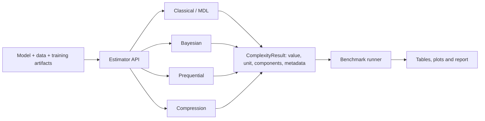

# DL Complexity

**Theoretically informed deep learning model complexity estimation** — библиотека и
экспериментальный стенд для сопоставимой оценки сложности моделей глубокого обучения.

[Документация пользователя](docs/README.md) содержит быстрый старт и выбор методов.
В [руководстве](docs/CODE_WALKTHROUGH.md) разобраны вызовы, формулы и ограничения,
в [справочнике API](docs/API_REFERENCE.md) — публичные сигнатуры и параметры.
[Карта исходников](src/dl_complexity/README.md) описывает модули и базовые интерфейсы.

## Идея и задача

Число параметров плохо объясняет, почему сильно перепараметризованные нейросети способны
обобщать. Проект рассматривает сложность как стоимость описания модели и данных либо как
приближение байесовского evidence. Его задача — реализовать несколько теоретически
обоснованных оценок под единым интерфейсом и проверить, какие из них лучше предсказывают
качество обобщения нейросетей.

Основной исследовательский вопрос: **насколько значение и ранжирование оценок сложности
согласуются с test NLL, generalization gap и устойчивостью модели при изменении размера
выборки, архитектуры и регуляризации?**

Все кодовые длины должны возвращаться в `nats` и/или `bits`, а также в нормированном виде
на один объект. Вместе с числом метод обязан сохранять допущения, составляющие оценки,
время вычисления и конфигурацию эксперимента. AIC/BIC-подобные критерии нельзя считать
универсальной «истинной сложностью» нейросети: проект сравнивает приближения и явно
указывает область применимости каждого из них.

## Методы и ответственные

| Ветка | Методы | Ответственный |
| --- | --- | --- |
| Классические и базовые MDL | AIC, BIC, HQIC, WAIC, WBIC, 2-part MDL | Алябушев |
| Байесовские коды | variational coding; KFAC-Laplace approximation of evidence; связь с MDL | Дементьев |
| Последовательные коды | blockwise prequential coding, online/replay-варианты, калибровка | Курдюков |
| Компрессионные оценки | pruning, low-rank/quantization и compression-based generalization bound | Чирков |

Граница ответственности включает формулу и допущения метода, реализацию общего
интерфейса, минимальный воспроизводимый пример и unit-тесты своей ветки. Сложные методы
сначала реализуются для небольших MLP/CNN; масштабирование не должно задерживать PoC.

## Планируемая архитектура



Планируемый стек: Python 3.11+, PyTorch, NumPy/SciPy, pandas, scikit-learn;
`pytest` и coverage для тестов, MkDocs для документации. Для кривизны допускается
KFAC/Laplace-бэкенд, но публичный API проекта не должен зависеть от конкретной реализации.

Бенчмарк фиксирует seed, split и бюджет обучения и сравнивает семейство MLP/CNN разной
ширины, глубины и регуляризации сначала на синтетике, затем на MNIST/Fashion-MNIST.
Отчёт содержит complexity score, test NLL, generalization gap, время и память, а также
ранговую корреляцию сложности с качеством обобщения.

## Роли команды

| Участник | Обязанности и проверяемый результат |
| --- | --- |
| **Алябушев** | Совместное планирование; протокол бенчмарков и PoC; реализация AIC/BIC/HQIC, затем WAIC/WBIC и 2-part MDL; итоговые сравнительные таблицы. |
| **Дементьев** | Совместное планирование; variational coding и KFAC-Laplace evidence; единая упаковка модулей в устанавливаемую библиотеку и контроль API; тестовая инфраструктура и coverage > 90%. |
| **Курдюков** | Совместное планирование; blockwise и online/replay prequential coding; справочник публичного API и методические примеры; воспроизводимое финальное демо. |
| **Чирков** | Совместное планирование; compression-based оценка и bound; блог-пост с понятной интерпретацией результатов; технический отчёт на 3–5 страниц (abstract, introduction, methods, experiments). |

Каждый участник делает минимум одно cross-review чужой ветки. Предлагаемый цикл ревью:
Алябушев → Дементьев → Курдюков → Чирков → Алябушев.

## Этапы

1. **Tech meeting 1:** утвердить формулы, единицы, API, датасеты и план экспериментов.
2. **Tech meeting 2:** показать end-to-end PoC на общем интерфейсе, промежуточную
   документацию, блог-пост и техотчёт.
3. **Checkpoint:** собрать методы в устанавливаемый пакет и провести cross-review.
4. **Tech meeting 3:** запустить общие бенчмарки, добиться coverage > 90%, показать демо
   и представить итоговые выводы.

## Литература

Индекс первоисточников и локальные PDF находятся в [`literature/`](literature/README.md).

## Проверка на аналитических эталонах

В [`tests/`](tests/README.md) находятся обычные pytest-тесты, включая проверки на
простых моделях с независимо известным ответом. Они входят в репозиторий и исходный
пакет (`sdist`), не требуют внешних отчётов, скачивания данных или обучения большой сети.

- `test_analytical_criteria.py` — MLE нормальной и Bernoulli-моделей, OLS,
  AIC/BIC/HQIC и WAIC с точным дискретным posterior;
- `test_analytical_bayesian.py` — Gaussian evidence, KFAC-Laplace, VI и WBIC;
- `test_analytical_codes_bounds.py` — последовательные коды, реальный codec,
  pruning/low-rank/quantization и реализованная часть Arora;
- `test_analytical_integration.py` — checkpoint, нормы и аналитические производные.

Из корня проекта в окружении с зависимостями из `pyproject.toml`:

```bash
python -m pytest -q
python -m pytest -q -k analytical
```

Краткие теоретические расчёты, численные значения, допуски и карта остальных файлов —
в [`tests/README.md`](tests/README.md). Проверки разделены по методам и охватывают
численные значения, формы тензоров и публичные вызовы. Метрики обучения на случайной
выборке не заменяют аналитический эталон.

Тесты различают точные формулы, WAIC по конечному набору значений и оценки
Монте-Карло с отдельным допуском. Для Arora проверяются Matrix-Project и условная
Theorem 2.1.

## Текущая структура

- `src/dl_complexity/` — общее ядро, criteria, bayesian, coding, compression, bounds,
  diagnostics и PyTorch-интеграции;
- `tests/` — численные эталоны и проверки общего публичного контракта;
  [`tests/README.md`](tests/README.md) — структура тестов и краткие расчёты;
- `examples/quickstart.py` — небольшой пример модели, данных и совместной оценки;
- `pyproject.toml` — упаковка src-layout и конфигурация тестов;
- `literature/` — первоисточники и навигация по ним;
- `presentation/` — презентация архитектуры и BIC PoC; предыдущая версия сохранена в архиве;
- `NEXT_STEPS.md` — актуальный план реализации.

Python-пакет — `dl_complexity`.
Общий вызов: `method.estimate(context, data=data)` либо `method.estimate(inputs=prepared)`.
`ComplexitySuite` объединяет методы и явно сообщает о нехватке их входов. Результат
сохраняет kind, units и components: native IC, кодовая длина и граница риска не становятся
одной шкалой. Обучение и подготовка posterior/curvature/prefix artifacts выполняются явно.

Поддерживаемые варианты: WAIC2 (`ddof=1`); WBIC по переданным tempered likelihood;
negative ELBO для заданных q/prior; KFAC с явными факторами и точной подготовкой для одного
Gaussian Linear; blockwise CI/FS, online и uniform-prefix replay; weight-only сжатие с
бинарным codec. Для Arora реализованы Matrix-Project (Algorithm 1) и условная Theorem 2.1
с полным sample certificate. Полная noise-stability Theorem 4.1 в этот API не входит.
WBIC требует готовых температурных выборок, а KFAC для произвольной сети — готовых факторов.

Основная презентация — **архитектура библиотеки и BIC proof of concept**, 6 слайдов на английском:
[PDF](presentation/proof-of-concept/main.pdf),
[LaTeX-исходник](presentation/proof-of-concept/main.tex),
[сборка и пример запуска](presentation/README.md).
Предыдущая презентация Tech Meeting 1 сохранена в
[архиве](presentation/archive/tech-meeting-1/dl_complexity_presentation.pdf).
