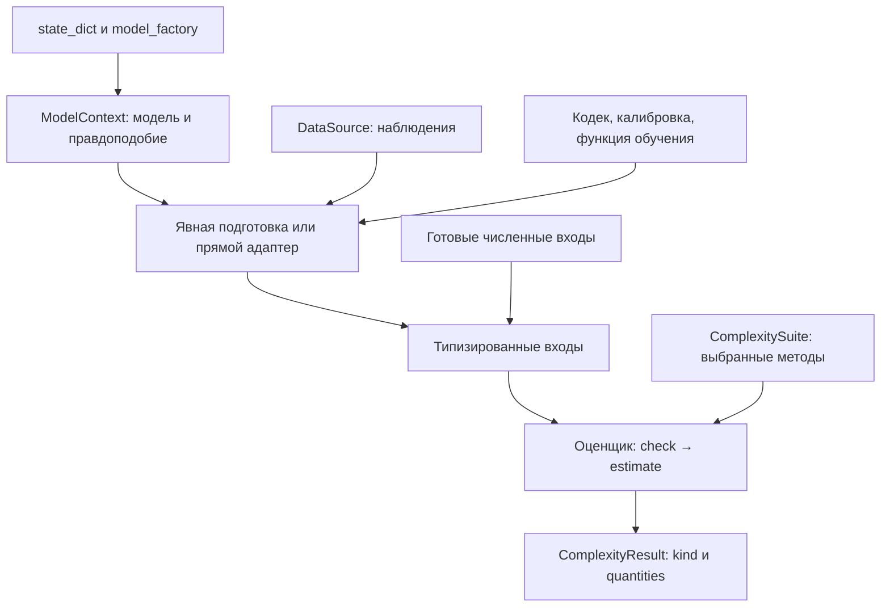

# DL Complexity: руководство по оценке сложности моделей

DL Complexity принимает обычные модели PyTorch и подготовленные численные входы. В этом руководстве описаны выбор метода, необходимые данные, вызов оценки и чтение результата. Версия `0.1.0a1` поддерживает перечисленные ниже варианты методов. Ограничения реализации указаны в соответствующих разделах.

## Оглавление

- [С чего начать](#reading-and-style)
- [Как взаимодействуют объекты](#object-flow)
- [Модель, данные и общий вызов](#core-objects)
- [Правдоподобие и явное обучение](#core-torch)
- [Статистики весов](#core-diagnostics)
- [AIC, BIC, HQIC и WAIC](#sb-methods)
- [Байесовские оценки](#sb-bayesian)
- [Двухчастные и последовательные коды](#coding-guide)
- [Преобразования весов и кодирование модели](#compression-guide)
- [Matrix-Project и граница Arora](#arora-guide)
- [Примеры, проверки и ограничения](#practical-reading)

<a id="reading-and-style"></a>

## С чего начать

Для первого вызова достаточно [примера quickstart](../examples/quickstart.py). Сигнатуры конструкторов, методов и входных записей собраны в [справочнике API](API_REFERENCE.md). [Карта исходников](../src/dl_complexity/README.md) описывает устройство пакета и его внутренние вычисления.

Выберите метод по сведениям, которые у вас уже есть:

| Что есть у пользователя | Что можно вычислить | Что потребуется дополнительно |
|---|---|---|
| Веса и архитектура модели | Нормы, число параметров, разреженность | `ModelContext` либо явно выбранные `WeightInputs` |
| Модель и выборка | AIC, BIC, HQIC | Явное правдоподобие, статистическая размерность `k`, условия применимости критерия |
| Матрица правдоподобий для выборок из апостериорного распределения | WAIC | Пообъектные значения `[S,N]`, полученные из обычного апостериорного распределения |
| Правдоподобия для температурного апостериорного распределения | WBIC | Температура `beta=1/ln(n)` и соответствующие выборки параметров |
| Вариационное и априорное распределения | Отрицательный ELBO | Готовые `VariationalTerms` либо функция полной NLL для явной подготовки |
| Значения в MAP и кривизна | Laplace/KFAC | Нормированная априорная плотность и `LaplaceTerms` либо `KFACFactors` |
| Модель, кодек и данные | Двухчастный MDL | Явная подготовка кода и правдоподобие декодированной модели |
| Упорядоченные данные и процедура обучения | Последовательный код | Фабрика моделей, функции обучения и журнал предсказаний до раскрытия ответов |
| Конечное представление сжатой модели и вся обучающая выборка | Реализованная граница Arora | Сертификат искажений и независимость фиксированного семейства от данных |

Обычный checkpoint подходит для статистик весов. Для критериев по правдоподобию к нему нужно добавить данные и вероятностную модель наблюдений. WAIC, WBIC и последовательный код требуют сведений, которых в конечных весах нет.

Оценки `O(...)` в руководстве относятся к работе текущих алгоритмов. Это не измерения времени CPU или GPU. Цена подготовки входов рассматривается отдельно от формулы по готовым числам. Например, BIC по `FitStatistics` вычисляется за `O(1)`, а получение этой статистики требует прохода по данным. Проверки `isfinite`, `.item()` и `bool(tensor)` могут синхронизировать GPU с CPU.

<a id="object-flow"></a>

## Как взаимодействуют объекты



`ModelContext` ссылается на модель. Оценщик хранит настройки метода. Подготовленные записи, такие как `FitStatistics`, `VariationalTerms` и `PrequentialLedger`, содержат входы конкретных формул. Общий вызов возвращает `ComplexityResult` с именованными величинами и их единицами.

Подготовку, которая обучает модель, сэмплирует параметры или кодирует веса, пользователь запускает отдельно. Прямой вызов `BIC().estimate(ctx, data=data)` выполняет только оценку правдоподобия уже заданных весов. При вызове `BIC().estimate(inputs=statistics)` модель вообще не исполняется.

В `ComplexitySuite` можно объединить методы разных семейств. Их результаты остаются отдельными: `native_ic`, кодовая длина, норма весов и граница риска имеют разные интерпретации. Общей сортировки этих величин библиотека не задаёт.

<a id="core-objects"></a>

## Модель, данные и общий вызов

В оценках затрат ниже `P` — число элементов выбранных параметров, `V` — число элементов буферов модели, `U` — число объектов `Parameter`, `M` — число модулей. Обозначения `n` и `b` относятся к числу наблюдений во всей выборке и в пакете данных. `F_b` — стоимость прямого прохода, `A_b` — сохранённые для него активации autograd.

### Контекст модели

`ModelContext(model, ...)` принимает существующую `nn.Module`. Он хранит ссылки на модель и дополнительные сведения:

- `loss` — функцию потерь для обучения, если она нужна.
- `likelihood` — вызываемый объект либо объект с `log_prob(prediction, target)`.
- `training` — необязательный `TrainingRecipe`.
- `state_id`, `likelihood_id` — идентификаторы, заданные пользователем.
- `loss_likelihood_relation` — описание связи `loss` и правдоподобия, по умолчанию `unspecified`.
- `runs` — метаданные вызовов `run_training`.

Создание контекста занимает `O(1)` сверх переданной конфигурации. Модель при этом не копируется и не обучается. Библиотека не выводит правдоподобие из произвольной функции потерь и не проверяет алгебраическую связь, записанную в `loss_likelihood_relation`. При интерпретации AIC или Laplace пользователь отдельно обосновывает, что веса соответствуют MLE или MAP.

`ctx.structure` возвращает `ModelStructure`: пары «путь модуля, имя класса» и описания параметров. В описании параметра есть имя, форма, признак `requires_grad` и первое имя того же объекта при наличии связанных параметров. Метаданные пересчитываются при каждом обращении. Для `A` имён параметров, включая повторные ссылки, требуются `O(M+A)` времени и памяти, плюс длины форм. Значения весов не копируются. Операции прямого прохода и активации в эту структуру не входят.

### Загрузка checkpoint

Вызов `ModelContext.from_checkpoint(path, model_factory=..., map_location="cpu", **kwargs)`:

1. Создаёт модель через `model_factory()`.
2. Загружает обычный `state_dict` с `torch.load(..., weights_only=True)`.
3. Проверяет соответствие `dtype` каждого совпадающего тензора, чтобы исключить неявное приведение float64 к float32.
4. Передаёт веса в `load_state_dict(..., strict=True)`, который проверяет ключи и формы.
5. Возвращает контекст с дополнительными полями из `kwargs`, например с `likelihood` и `state_id`.

Архитектуру нужно задать фабрикой: восстановить её из одного `state_dict` нельзя. Словарь `{"state_dict": ..., "optimizer": ...}` автоматически не распаковывается. `map_location` управляет загрузкой тензоров, а конечные параметры находятся на устройстве модели, созданной фабрикой.

Для файла размера `C` чтение и копирование требуют `O(C+P+V)`. В памяти одновременно находятся модель и загруженный словарь весов. Инициализация внутри фабрики может расходовать RNG. `weights_only=True` ограничивает загрузку объектов, но не делает произвольный файл доверенным.

### Источник данных

`DataSource(batches, n_observations=None, data_id=None)` принимает пары `(inputs, targets)`. В `batches` можно передать повторно итерируемый объект, одноразовый итератор или фабрику нового итератора. `n_observations` означает число наблюдений, а не число пакетов данных.

`DataSource.from_tensors(inputs, targets, data_id=...)` проверяет совпадение первой оси и оборачивает оба тензора в один повторно доступный пакет. Значения не копируются, разбиения на мини-пакеты нет. Создание такой оболочки занимает `O(1)`.

Свойство `.one_shot` обнаруживает существующий итератор по `__next__`, не читая данные и не вызывая фабрику. Произвольный итерируемый объект может всё же возвращать один исчерпываемый итератор при каждом обращении. Для нескольких методов используйте фабрику свежих итераторов или заранее подготовленные численные входы.

### Результат и единицы

`ComplexityResult` содержит `method`, `kind`, отображение `quantities`, необязательное `primary_name`, условия `assumptions`, конфигурацию, `provenance` и время. Значения в `quantities` обёрнуты в `Quantity(value, unit, normalization="total")`.

Основная величина доступна как `result.primary`, её тензор — как `result.primary.value`. У диагностики весов `.primary` равен `None`, поэтому её именованные статистики читают из `result.quantities`. Величины могут сохранять граф autograd. Python-числа при создании `Quantity` становятся CPU-тензорами float64, существующие тензоры с плавающей точкой сохраняют `dtype` и `device`.

`quantity.to("bits")` меняет основание логарифма:

$$
L_{bits}=L_{nats}/\ln 2,\qquad L_{nats}=L_{bits}\ln 2.
$$

Для прежней единицы возвращается тот же объект. Перевод nats↔bits требует `O(T)` времени и новой памяти для `T` элементов `value`, сохраняя autograd. Перенести тензор на другое устройство этим методом нельзя. Единицы `native_ic`, `probability` и нормы весов в bits не переводятся.

`quantity.per_observation(n)` делит полную величину на положительное число наблюдений и помечает нормировку `per_observation`. Метод принимает только полные nats, bits или native IC. Повторное нормирование и деление границы риска отклоняются. Расчёт стоит `O(T)` и не читает данные заново.

`Provenance(state_id, data_id, likelihood_id)` хранит объявленные идентификаторы. Совпадение строк не доказывает совпадения весов или выборки. После изменения модели пользователь должен обновить её `state_id`. Значение `None` означает, что идентичность неизвестна. Записи с `frozen=True` запрещают переназначение полей, но вложенные отображения и тензоры остаются изменяемыми.

### Проверка и оценка

Перед расчётом можно вызвать `method.check(context, data=data, inputs=...)`. Он возвращает `RequirementReport`:

| Статус | Действие пользователя |
|---|---|
| `READY` | Можно вызвать `estimate` с теми же входами |
| `MISSING_INPUTS` | Добавить сведения из `report.missing` |
| `PREPARATION_REQUIRED` | Выполнить явную подготовку из `report.actions` |
| `UNSUPPORTED` | Выбрать поддерживаемый вариант модели или входов |

Проверка не запускает прямой проход, обучение или сэмплирование и не расходует итератор данных. Её стоимость зависит от метода. Например, проверка последовательного журнала обходит записи, а сравнения скалярных тензоров могут синхронизировать ускоритель. `READY` означает достаточность входов, но не подтверждает iid, MLE/MAP или сходимость апостериорного распределения.

`method.estimate(context=None, *, data=None, inputs=None)` повторяет проверку и поднимает `InputError` либо `PreparationRequired`, если входов недостаточно. Для поддерживаемого прямого маршрута он готовит статистику модели, затем вычисляет оценку. При переданном `inputs` используется готовая запись. Если одновременно заданы контекст или данные, их заданные идентификаторы должны согласоваться с `provenance` записи.

Конструкторная конфигурация доступна в `.config` как неглубокая копия словаря. В `result.config` она объединяется с фактическими метаданными расчёта, причём последние имеют приоритет. Поле `elapsed_seconds` начинается после проверки и включает разрешённую подготовку и формулу. Оно измеряется через `perf_counter` без явной синхронизации CUDA/MPS. Для сравнения времени на ускорителе нужны отдельные измерения с одинаковыми границами подготовки.

### Несколько оценок в одном вызове

`ComplexitySuite({name: estimator}, errors="raise"|"collect")` принимает явно выбранные методы. Его аргумент `inputs` — словарь «имя метода → типизированная запись», тогда как отдельный оценщик принимает одну запись.

`suite.check(...)` возвращает словарь `RequirementReport`. `suite.estimate(...)` возвращает словарь `EvaluationOutcome` с полями `result`, `requirements` и `error`. При `errors="raise"` известная нехватка входов останавливает весь набор до расчётов. При `errors="collect"` неподготовленные методы сохраняют отчёт, а обычные ошибки выполнения попадают в `.error`. Неизвестные имена входов отклоняются в обоих режимах.

Методы выполняются последовательно в порядке словаря. Если нескольким из них нужен один одноразовый `DataSource`, набор отклоняет вызов до чтения данных. `WeightStatistics` данные не читает, поэтому его можно сочетать с BIC на одном одноразовом источнике. Ошибка второго метода не отменяет уже выполненные вычисления первого.

Время равно сумме проверок и оценок, память включает результаты и удерживаемые ими графы autograd. Общее число методов обозначим `K`. Служебные расходы набора составляют `O(K)` плюс обработка имён входов. Чтобы AIC, BIC и HQIC не повторяли проход по данным, один раз получите `FitStatistics` и передайте тот же объект трём именам. Автоматического кэша правдоподобия в suite нет.

<a id="core-torch"></a>

## Правдоподобие и явное обучение

### Что происходит с моделью при оценке

Прямой маршрут вычисления правдоподобия использует независимую копию модели в режиме `eval`. Исходные параметры, буферы и режимы модулей сохраняются. Для вычисления вызывается `torch.func.functional_call` с клонами исходных параметров и буферов.[^torch-functional] Если копирование модели невозможно, передайте готовые численные входы.

При включённом вычислении градиентов клоны параметров связаны с оригиналами через autograd. Поэтому производная рассчитанного правдоподобия может дойти до исходного `Parameter`. Подготовка требует `O(P+V+M)` времени и памяти примерно для двух дополнительных наборов `P+V`: копии модели и отдельных клонов состояния. К ним добавляются активации прямого прохода.

Кортеж `inputs` раскрывается в позиционные аргументы модели. Другой объект передаётся одним аргументом. Именованные аргументы `forward` автоматически не восстанавливаются.

Для обычного маршрута вычисления правдоподобия и `run_training` сохраняются и восстанавливаются состояния Torch RNG на CPU, CUDA-устройствах параметров и буферов, а также MPS при наличии тензоров модели на MPS. Обход устройств зависит от числа объектов параметров и буферов, а не от числа элементов весов. Python `random`, NumPy RNG и внешние действия пользовательских функций не откатываются. Пользовательский `__deepcopy__` исполняется до внутренней области сохранения RNG. У подготовки Arora более узкий охват RNG, описанный в её разделе.

### Категориальное правдоподобие

`CategoricalLikelihood().log_prob(prediction, target)` принимает логиты `[b,C]` и индексы классов `torch.long` формы `[b]`. После `log_softmax` функция выбирает логарифм вероятности истинного класса через `gather`. Возвращается `[b]` без усреднения:

$$
\ell_i = z_{i,y_i}-\log\sum_{c=1}^{C} e^{z_{i,c}}.
$$

Время и основной промежуточный массив имеют порядок `O(bC)`, результат занимает `O(b)`. Производные по логитам сохраняются. В адаптере нет сглаживания меток, весов классов или поддержки мягких ответов.

### Гауссовское правдоподобие

`GaussianLikelihood(sigma)` использует известное положительное конечное стандартное отклонение. Предсказание и ответ должны иметь одинаковую форму `[b,...event_axes]`. Для события с `E` координатами функция суммирует логарифмические плотности координат:

$$
\ell_i=-\frac{\|y_i-\mu_i\|^2}{2\sigma^2}-E\log\sigma-\frac E2\log(2\pi).
$$

Возвращается один элемент на наблюдение. Время и промежуточные массивы имеют размер `O(bE)`. Производные сохраняются по предсказанию и другим тензорным входам с `requires_grad`. `sigma` хранится как обычное число.

Логарифмическая плотность непрерывных данных может быть положительной, а NLL — отрицательной. Для интерпретации как кода данных нужно задать точность кодирования и соответствующую поправку.

### Общая статистика правдоподобия

`prepare_fit_statistics(context, data=data, parameter_count="trainable"|"all"|k)`:

1. Требует явно заданный `context.likelihood`. Одного `context.loss` недостаточно.
2. Выбирает `k`: число элементов уникальных `Parameter`, только обучаемых или всех, либо заданное неотрицательное целое.
3. Выполняет изолированный прямой проход по каждому пакету данных.
4. Требует от правдоподобия пообъектный результат `[b]`, проверяет конечность значений и суммирует их.
5. Считает увиденное число наблюдений и сверяет его с `DataSource.n_observations`, если оно задано.
6. Возвращает `FitStatistics(total_log_likelihood, k, n, provenance)`.

Число элементов весов само по себе не равно эффективному числу степеней свободы нейросети. Если формуле нужна другая статистическая размерность, передайте `k` явно.

Стоимость прохода:

$$
O(P+V+M)+\sum_{batch}(F_b+L_b),
$$

Здесь `L_b` включает вычисление правдоподобия и проверки. Выбор `k` по формам параметров стоит `O(U)` и не требует сканирования всех значений весов.

Функция сохраняет текущий режим вычисления градиентов. При включённом autograd сумма правдоподобий удерживает графы всех пакетов, то есть примерно `Σ A_b` активаций. Если последующий обратный проход не нужен, вызывайте подготовку или оценку внутри `with torch.no_grad():`. Тогда рабочие активации ограничены текущим пакетом, сверх копий состояния модели. Проверки конечности всё равно могут синхронизировать GPU с CPU.

### Запуск прикреплённого обучения

Прикрепите `TrainingRecipe(train, objective, config)` к контексту и явно вызовите `run_training(ctx, seed=...)`. Функция создаёт независимую копию модели и исполняет `train(model_copy, **config)`. Оптимизатор, данные и режим `train/eval` задаёт пользовательская функция.

Возвращаемый `TrainingRun` содержит обученную копию, фактическое значение `returned`, объявленную цель, конфигурацию, внешний `rng_seed` и статус. Чтобы оценить обученные веса, создайте новый `ModelContext(run.model, ...)`. Исходная `ctx.model` автоматически не заменяется.

В `ctx.runs` добавляется `TrainingRecord` со статусом `completed` или `failed` при обычном исключении. Ошибка затем пробрасывается. Ошибки до фактического вызова функции обучения и прерывания `BaseException` не гарантируют запись истории. Ключ `config["seed"]`, если он есть, передаётся функции обучения отдельно от внешнего seed генератора Torch.

Копирование требует `O(P+V+M)`, затем добавляются время и память пользовательского обучения. Библиотека не архивирует градиенты и активации. Значение `returned` и элементы конфигурации могут содержать тензоры, замыкания и вычислительные графы, время жизни которых контролирует вызывающий код.

<a id="core-diagnostics"></a>

## Статистики весов

`WeightStatistics(trainable_only=False, spectral=False)` можно вызвать с контекстом без данных и правдоподобия либо с `WeightInputs(weights, provenance=None)`. Во втором случае пользователь сам выбирает отображение имён в тензоры. При передаче всего `state_dict` буферы не отделяются от параметров автоматически.

Расчёт проверяет конечность тензоров с плавающей точкой и учитывает повторные ссылки на один объект только один раз. Возвращаются:

- `name.l2` — евклидова норма элементов каждого выбранного тензора.
- `name.spectral` — максимальное сингулярное число двумерного тензора при `spectral=True`.
- `parameter_count`, общие `l1`, `l2` и `sparsity`, то есть доля точных нулей.

Для общих статистик тензоры должны иметь одинаковые `dtype` и `device`. Результат имеет `kind="weight_diagnostics"` и `.primary=None`.

Без спектральных норм требуются `O(P)` времени и дополнительной памяти для общего вектора весов. Неконтинуальные тензоры при `reshape` могут потребовать копии. Спектральные нормы добавляют примерно `Σ O(m_i n_i min(m_i,n_i))` и рабочую память линейной алгебры. Для свёрточного тензора `[out,in,kH,kW]` спектральная норма пропускается: норма развёрнутой матрицы не равна автоматически норме оператора свёртки.

L1, L2 и спектральная норма сохраняют autograd там, где производная определена. Разреженность использует дискретное сравнение. Совпадение адресов памяти у разных тензорных объектов не устраняет повторный учёт: дедупликация основана на `id(tensor)`.

Диагностический `parameter_count` хранится в типе весов с плавающей точкой. Для больших чисел float16/float32 могут округлять целые значения. Для точного количества используйте Python `int`, например сумму `numel`. Поле `FitStatistics.k` отдельно хранится как Python `int`, поэтому округление диагностики не меняет вычисление IC.

<a id="sb-methods"></a>

## AIC, BIC, HQIC и WAIC

В этом разделе `N` — число наблюдений, `S` — число выборок параметров, `k` — заданная статистическая размерность. [Описание семейства](../src/dl_complexity/criteria/README.md) связывает методы с исходниками.

### Подготовленные входы

`FitStatistics(log_likelihood, k, n=None, provenance=None)` содержит сумму натуральных логарифмов правдоподобия. Регуляризаторы, такие как weight decay, в неё не входят. `n` обязательно для BIC и HQIC, но не для полного AIC.

Конструктор сохраняет поля по ссылке за `O(1)`. Числовые условия проверяет оценщик. Политика `parameter_count` в конструкторах AIC/BIC/HQIC действует только при оценке через контекст. Она не заменяет уже заданное `FitStatistics.k`.

`PosteriorLogLikelihood(log_likelihood, provenance=None)` хранит матрицу `[S,N]`. Строки соответствуют выборкам из обычного апостериорного распределения, столбцы — наблюдениям после суммирования координат события. Подготовленная пользователем матрица занимает `O(SN)`. Контейнер не создаёт апостериорное распределение и не проверяет сходимость выборок.

### AIC, BIC и HQIC

Все три метода выделяют девианс `-2ℓ`, вычисляют штраф и возвращают сумму с компонентами `deviance` и `penalty`:

$$
\mathrm{AIC}=-2\ell+2k,\qquad
\mathrm{BIC}=-2\ell+k\ln n,\qquad
\mathrm{HQIC}=-2\ell+2k\ln\ln n.
$$

Основная величина называется `aic`, `bic` или `hqic`, её единица — `native_ic`. Расчёт по готовому `FitStatistics` требует `O(1)` времени и памяти. Для контекста сначала выполняется описанный выше проход вычисления правдоподобия.

AIC допускает отсутствие `n`. Для BIC нужно `n≥1`, для HQIC — `n>1`. При `n=2` штраф HQIC отрицателен и сохраняется без обрезания. BIC не делится на два. Оценщики также не проверяют, что переданные веса являются MLE и что выполнены условия асимптотики.

По тензорному `ℓ` сохраняется производная девианса `-2`. `k` и `n` заданы как целочисленные метаданные и не становятся обучаемыми параметрами.

```python
from dl_complexity.criteria import AIC, BIC, HQIC, FitStatistics

stats = FitStatistics(log_likelihood=-100.0, k=3, n=100)
for method in (AIC(), BIC(), HQIC()):
    result = method.estimate(inputs=stats)
    print(result.method, result.primary.value.item(), result.primary.unit)
# AIC: 206.0
# BIC: 213.81551055796427
# HQIC: 209.1630777548474
```

### WAIC

WAIC требует матрицу апостериорных правдоподобий. Одних `ℓ`, `k` и конечных весов для него недостаточно. Реализован вариант WAIC2 с выборочной дисперсией `ddof=1`, поэтому нужны `S≥2` и `N≥1`.

Для каждого наблюдения вычисляется логарифм среднего правдоподобия по выборкам параметров. Используется `logsumexp`, чтобы избежать переполнения и потери малых значений. Затем по каждому столбцу вычисляется выборочная дисперсия логарифмического правдоподобия:

$$
\operatorname{lppd}=\sum_{i=1}^{N}\left[\operatorname{logsumexp}_{s=1}^{S}\ell_{si}-\ln S\right],
\quad
p_{\mathrm{WAIC}}=\sum_{i=1}^{N}\operatorname{Var}_{s}(\ell_{si};\,\mathrm{ddof}=1),
$$

$$
\operatorname{elpd}_{\mathrm{WAIC}}=\operatorname{lppd}-p_{\mathrm{WAIC}},
\qquad
\mathrm{WAIC}=-2\operatorname{elpd}_{\mathrm{WAIC}}.
$$

Время расчёта — `O(SN)`. Входная матрица, промежуточные проверки и autograd могут занимать `O(SN)` памяти. Результат содержит `waic` в native IC, `lppd` и `elpd_waic` в nats, `p_waic` с единицей `dimensionless`. Сэмплер и оценка погрешности Монте-Карло в метод не входят.

```python
import torch
from dl_complexity.criteria import PosteriorLogLikelihood, WAIC

# Чистый численный эталон для reducer, не утверждение о реальном posterior.
log_likelihood = torch.tensor(
    [[0.5, 0.25], [0.25, 0.5]], dtype=torch.float64
).log()
result = WAIC().estimate(inputs=PosteriorLogLikelihood(log_likelihood))
print(result.primary.value.item())  # 4.884223039883308
```

<a id="sb-bayesian"></a>

## Байесовские оценки

WBIC, вариационная свободная энергия и Laplace используют разные подготовленные величины. Их общий API описан в [байесовском семействе](../src/dl_complexity/bayesian/README.md).

| Вход | Что нужно передать | Память исходных чисел |
|---|---|---|
| `TemperedLikelihood` | Вектор полных логарифмических правдоподобий `[S]`, `n`, `beta`, `provenance` | `O(S)` |
| `VariationalTerms` | Скаляры `expected_nll`, `kl_divergence`, необязательное `n`, вид оценки KL | `O(1)` сверх графов получения этих чисел |
| `LaplaceTerms` | Полные `log_likelihood`, нормированный `log_prior`, `logdet_precision`, размерность | `O(1)` без внешнего вычисления логарифма определителя |
| `KroneckerBlock` | PSD-факторы `A[a,a]`, `G[g,g]`, положительный `scale` | `O(a²+g²)` |
| `KFACFactors` | Правдоподобие, априорная плотность, набор блоков, изотропная априорная точность `prior_precision=α`, `curvature_kind` | `O(Σ_b(a_b²+g_b²))` |

Эти записи создаются за `O(1)` без копирования тензоров. В предварительных проверках WBIC, VI и KFAC тензорные значения не сканируются. Конечность, положительность и PSD-условия проверяются при численном расчёте.

### WBIC

Передайте полные значения логарифмического правдоподобия для распределения

$$
p_\beta(\theta\mid D)\propto p(\theta)\,p(D\mid\theta)^\beta,
\qquad \beta=1/\ln n.
$$

Обычное апостериорное распределение не подходит вместо температурного. Метод проверяет `n>1`, соответствие `beta` и форму `[S≥1]`, затем считает

$$
\operatorname{WBIC}=-\frac1S\sum_{s=1}^{S}\ell_s.
$$

Дополнительных множителей `β` или `2` нет. Время — `O(S)`, память входов и проверок может составлять `O(S)`. Основной результат `wbic` возвращается в nats. Получение температурных выборок и проверка смешивания цепи остаются за пользователем.

### Вариационная свободная энергия

`VariationalCode` вычисляет отрицательный ELBO:

$$
F(q)=\mathbb E_q[-\log p(D\mid\theta)]+\operatorname{KL}(q\Vert p),
$$

По готовому `VariationalTerms` метод проверяет два конечных скаляра и складывает их за `O(1)`. Возвращаются `negative_elbo`, `expected_nll` и `kl_divergence` в nats. Python-константы согласуются с типом и устройством переданного тензора. Два тензорных входа должны быть совместимы, переноса одного на устройство другого нет.

`n` сохраняется в конфигурации и не меняет масштаб термов. Ожидается NLL по всей выборке. Отрицательный аналитический KL отклоняется, отрицательная оценка Монте-Карло допускается из-за её случайной погрешности. Результат не содержит реального сжатого файла.

```python
from dl_complexity.bayesian import VariationalCode, VariationalTerms

result = VariationalCode().estimate(
    inputs=VariationalTerms(expected_nll=12.0, kl_divergence=2.5, n=10)
)
assert result.primary.value.item() == 14.5
```

Для явной подготовки используйте `prepare_variational_terms(q, prior, total_nll, ...)`:

1. Задайте готовые распределения `q`, `prior` и функцию полной `total_nll(theta)`.
2. Укажите `n_samples=S`. Функция сразу получает все `S` выборок через `q.rsample`, если доступна репараметризация, иначе через `q.sample`.
3. Для каждой выборки вычисляется полная NLL, затем берётся среднее.
4. При `analytic_kl=True` вызывается зарегистрированная `torch.distributions.kl_divergence(q, prior).sum()`.
5. В режиме Монте-Карло отдельно суммируются `q.log_prob(theta)` и `prior.log_prob(theta)`, после чего их разность усредняется по выборкам.

Отдельное суммирование логарифмических плотностей нужно из-за соглашений об осях `batch_shape` и `event_shape`. Например, `Normal([d])` и `Independent(Normal([d]),1)` могут представлять одну совместную плотность с разными формами результата `log_prob`. Вычитание несведённых массивов привело бы к непреднамеренному расширению массивов по осям.

Для выборки параметров размерности `d` время равно `O(C_sample(S,d)+S·C_NLL+C_KL)` при аналитическом KL. В режиме Монте-Карло добавляется оценка двух плотностей для каждой выборки, часто `O(Sd)`. В памяти находятся все `O(Sd)` параметров, скалярные значения потерь и сохранённые графы пользовательской NLL. Функция расходует текущий RNG и не обучает `q` или сеть. При нерепараметризуемом `sample` оценщик градиента методом score-function автоматически не добавляется.

### Laplace и KFAC

`KFACLaplace` приближает отрицательный логарифм маргинального правдоподобия гауссовским интегралом около выбранной точки:

$$
-\log Z\approx -\ell(\theta_*)-\log p(\theta_*)
-\frac d2\ln(2\pi)+\frac12\log\det H_{\mathrm{posterior}}.
$$

Для интерпретации как маргинального правдоподобия точка должна быть MAP относительно объявленного нормированного априорного распределения. Выбор параметров, их размерность и соглашение о кривизне задаются явно. Гессиан, GGN и информацию Фишера нельзя взаимозаменять без обоснования.

С `LaplaceTerms` все необходимые скаляры уже готовы, поэтому формула требует `O(1)`. С `KFACFactors` метод вычисляет логарифм определителя каждого блока `s_b(G_b⊗A_b)+αI`.

Перед разложением факторы проверяются на конечность и симметрию. Абсолютный допуск равен `100·eps·max(1,max|factor|)`, относительный — `100·eps`. Собственные значения вычисляются для симметризованной матрицы `(M+Mᵀ)/2`. Значения ниже отрицательного допуска отклоняются, малые отрицательные погрешности округления обрезаются к нулю.

Далее создаётся таблица `[g,a]`:

$$
\lambda_{ji}=s\,\lambda_j(G)\lambda_i(A)+\alpha.
$$

Сумма `log(λ_ji)` даёт логарифм определителя блока, а `ag` добавляется к размерности. В результат входят `negative_log_evidence`, отрицательные логарифмы правдоподобия и априорной плотности, половина логарифма определителя и гауссовская нормировочная константа.

Для фактора `[m,m]` проверки стоят `O(m²)`, `eigvalsh` — `O(m³)`, память — `O(m²)`. Для набора блоков время составляет

$$
O\left(\sum_b(a_b^3+g_b^3+a_bg_b)\right).
$$

Рабочая память одного блока — `O(a²+g²+ag)` сверх переданных факторов. Autograd может удерживать промежуточные результаты всех блоков. Плотная матрица точности `[ag,ag]` потребовала бы `O(a²g²)` памяти и факторизации порядка `O((ag)³)`.

Добавление `αI` точное для выбранной кронекеровской аппроксимации. Оно отличается от добавления диагональных поправок к факторам `(A+aI)⊗(G+bI)`, где появляются дополнительные перекрёстные термы. Это не делает KFAC точным гессианом произвольной сети.

### Подготовка для гауссовской линейной регрессии

`prepare_gaussian_linear_kfac(model, x, y, noise_std=σ, prior_precision=α)` поддерживает точный встроенный тип `nn.Linear`, со смещением или без него. Подклассы с произвольным `forward` не поддерживаются. Число признаков с добавленной единицей для смещения обозначим `p`, число выходов — `g`, размер выборки — `N`.

Функция проверяет формы `x[N,input_features]`, `y[N,g]`, совпадение `dtype/device`, конечность данных и положительность `σ`, `α`. Предсказание вычисляется напрямую как `x @ weight.T + bias`. При наличии смещения к `x` добавляется столбец единиц. Затем вычисляются полное гауссовское правдоподобие, нормированная изотропная гауссовская априорная плотность всех весов и смещений, а также факторы

$$
A=X_{\mathrm{aug}}^TX_{\mathrm{aug}}/N,
\quad G=I_g/\sigma^2,
\quad s=N.
$$

Возвращается `KFACFactors` с одним блоком и `curvature_kind="exact_gaussian_linear_hessian"`. Масштаб `N` восстанавливает полную кривизну после усреднения `A`. Если переданные веса заранее являются MAP, этот случай даёт точный гауссовский эталон Laplace.

Время подготовки — `O(Npg+Np²+g²)`, дополнительная память — `O(Np+Ng+p²+g²+pg)`, плюс autograd. Функция не находит MAP. Для произвольной MLP/CNN общего сборщика факторов в библиотеке пока нет.

<a id="coding-guide"></a>

## Двухчастные и последовательные коды

Здесь `n` — число наблюдений, `C` — число классов, `B` — число записей журнала. `F(b)`, `Train(s)` и `Update(b)` обозначают время пользовательских функций предсказания и обучения. Их нельзя заранее выразить через одно число параметров. [Описание семейства кодов](../src/dl_complexity/coding/README.md) содержит карту модулей.

### Двухчастный MDL

`TwoPartInputs` хранит `model_bits`, `data_nll`, `n`, `provenance`, соглашение о коде данных и поправку на разрешение. По готовой записи `TwoPartMDL(unit="nats"|"bits")` проверяет конечность скаляров и допустимость кодовых затрат, затем считает

$$
   L_{\text{model}} = \text{model\_bits}\ln 2,\qquad
   L_{\text{data}} = \text{data\_nll}+\text{resolution\_adjustment\_nats},
   \qquad L=L_{\text{model}}+L_{\text{data}}.
$$

Для результата в bits оба слагаемых делятся на `ln(2)`. Возвращаются `total`, `model`, `data` и `per_observation`, основной ключ — `total`. Время и дополнительная память составляют `O(1)`, производные по переданным скалярным тензорам сохраняются.

В режиме `discrete` поправка должна быть нулевой. В режиме `quantized` плотность умножается на объявленный объём ячейки. Такое приближение вероятности не совпадает с точным интегрированием плотности по ячейке, поэтому результат помечается `kind="two_part_density_code_approximation"`. Неотрицательность суммы сама по себе не доказывает корректность произвольно заданного кода.

Если исходный объект — модель, вызовите `prepare_two_part(context, data=data, codec=codec)`:

1. Кодек формирует реальные байты из модели.
2. Эти байты декодируются в предиктор.
3. Декодированная модель переносится на устройство первого параметра исходной без общего приведения `dtype`. Смешанные типы весов сохраняются.
4. Для неё вычисляется правдоподобие на переданных данных. Идентификатор исходного состояния ей не приписывается.
5. Возвращается `TwoPartInputs` с физической длиной сообщения и NLL декодированного предиктора.

Стоимость подготовки равна кодированию, декодированию и полному проходу вычисления правдоподобия. В памяти находятся сообщение, декодированная модель, изолированные копии для интеграции и активации. Производные через дискретный encode/decode к исходным весам не проходят.

```python
from dl_complexity.coding import TwoPartInputs, TwoPartMDL

result = TwoPartMDL(unit="bits").estimate(
    inputs=TwoPartInputs(model_bits=8.0, data_nll=2.0, n=2)
)
# total = 8 + 2 / ln(2) bits; primary — Quantity, а не голый float.
```

### Журнал последовательного кодирования

`PrequentialEntry(start, stop, nll, trained_until, calibrated_until, replay_indices)` фиксирует стоимость полуоткрытого интервала `[start,stop)`. `trained_until` и `calibrated_until` описывают прошлое, доступное до предсказания. Индексы replay относятся к обновлению после кодирования текущего интервала. Уже раскрытые ответы этого интервала можно использовать, будущие — нельзя.

`PrequentialLedger(initial_nll, initial_count, entries, n, protocol, provenance)` объединяет начальный код и последующие интервалы. Сами записи создаются за `O(1)`, хранимые метаданные занимают `O(B+R_total)`, где `R_total` — суммарное число replay-индексов.

Оценщик проверяет, что интервалы без пропусков и перекрытий покрывают всю последовательность: первый начинается на `initial_count`, следующий — на предыдущем `stop`, последний заканчивается на `n`. Отклоняются обучение, калибровка и replay с доступом к будущим ответам. Эти проверки относятся к объявленным метаданным. Содержимое замыканий пользовательских функций они не контролируют.

`BlockwisePrequential`, `OnlinePrequential` и `ReplayPrequential` принимают журнал своего протокола. Стоимость кода равна `initial_nll+sum(entry.nll)`. NLL повторно используемых данных к коду не прибавляется. Время проверки и расчёта — `O(B+R_total)`, временная память суммирования — `O(B)`. Встроенные подготовки сохраняют NLL без графа. Если собственный журнал содержит дифференцируемые стоимости, их сумма может удерживать autograd.

### Подготовка по протоколам

`prepare_blockwise` реализует обучение заново на растущем префиксе, CI/FS. `boundaries` задаёт исключающие правые границы блоков. Первый блок кодируется начальным кодом, по умолчанию `b0*ln(C)`. Для каждого следующего блока создаётся новая модель. Функция `train(state, x[:start], y[:start])` обучает её только на прошлом и возвращает заменяющее состояние либо `None` при изменении на месте. Затем кодируется новый блок. При калибровке отдельный калибратор обучается на логитах и ответах прошлого префикса.

Время равно `sum_j[Train(start_j)+F(block_j)]`, плюс калибровка и дополнительные проходы по префиксам при её наличии. Обучение на одних наблюдениях повторяется. Тензорные срезы обычно являются представлениями исходных данных. Слабые ссылки помогают обнаружить повторно возвращённый живой `nn.Module`, не удерживая все модели. Если пользовательская функция сохраняет модели, проверки списка слабых ссылок суммарно могут стоить `O(B²)`. Журнал занимает `O(B)`.

`prepare_online` создаёт состояние один раз. Начальный префикс, если он есть, сначала кодируется и только затем передаётся в функцию обновления. Далее на каждом мини-пакете выполняются предсказание, запись NLL, обновление калибратора и `update(state, new_x, new_y)`. Оптимизатор и его состояние принадлежат пользовательской функции.

Помимо пользовательского обучения и калибровки категориальные вычисления занимают `O(nC)`. Сохраняется `O(B)` скалярных записей. Все логиты не удерживаются, но полные `x` и `y` уже находятся в памяти. Подготовка не является загрузчиком данных, превышающих оперативную память.

`prepare_replay` сохраняет порядок предсказания и записи стоимости. Функция обновления получает `(state, new_x, new_y, replay_x, replay_y)`. По умолчанию replay выбирается равномерно без возвращения из уже раскрытого префикса через `torch.randperm(stop)`. Seed задаёт начальное состояние локального генератора. Пользовательская `replay_policy(stop)` также может вернуть только индексы `<stop`.

Даже при `replay_size=1` создаётся вся перестановка префикса. Суммарное время генерации — `O(sum_j stop_j)`, до `O(n²/batch_size)` при постоянном размере мини-пакета. На шаге нужна перестановка `O(stop)` и копии выбранных данных. В журнале остаётся до `O(B*min(replay_size,n))` индексов. Оптимизированные replay-stream варианты статьи здесь не реализованы.

```python
import torch
from dl_complexity.coding import OnlinePrequential, prepare_online

x = torch.tensor([[0.0], [1.0]], dtype=torch.float64)
y = torch.tensor([0, 1])
ledger = prepare_online(
    x, y,
    model_factory=lambda: {},
    update=lambda state, new_x, new_y: None,
    predict_logits=lambda state, batch: batch.new_zeros((len(batch), 2)),
    n_classes=2,
)
result = OnlinePrequential(unit="bits").estimate(inputs=ledger)
# Uniform predictor: exactly two bits for two binary observations.
```

### Температурная калибровка

`TemperatureScaler` задаёт компонент предиктора. Его `log_probs(logits)` считает `log_softmax(logits/T)` для `[b,C]` за `O(bC)` времени и памяти. Производные по переданным логитам возможны, но предыдущий граф обучения температуры не сохраняется.

`update(logits, targets)` и его псевдоним `fit` отсоединяют логиты от сети и оптимизируют один `log_temperature` с помощью Adam. Положительность получается через `T=exp(log_temperature)`. Для `A` шагов требуются `O(AbC)` времени, `O(bC)` промежуточной памяти и скалярное состояние оптимизатора. Новый Adam создаётся при каждом обновлении, его моменты между мини-пакетами не переносятся. После обновления сохраняется только отсоединённая температура.

Предсказания внутри подготовки выполняются в `eval/no_grad`, после чего восстанавливается режим каждого модуля. Произвольные изменения буферов и внешние действия пользовательской функции не откатываются. Калибратор должен возвращать конечные нормированные логарифмы вероятностей той же формы. Все затраты записываются до передачи соответствующих ответов в обучение.

<a id="compression-guide"></a>

## Преобразования весов и кодирование модели

[Семейство сжатия](../src/dl_complexity/compression/README.md) включает преобразования модели, кодек и конечные представления Matrix-Project.

`ModelTransform.apply(model)` возвращает независимую преобразованную модель. `ModelCodec.encode(model)` возвращает `EncodedModel(payload: bytes)`, а `decode(encoded, model_factory=None)` восстанавливает описанный сообщением предиктор. Свойство `encoded.length_bits` равно `8*len(payload)` и вычисляется за `O(1)`. Оболочка не копирует байты, само сообщение занимает память пропорционально своей длине.

### Преобразования весов

Конструкторы трёх преобразований только проверяют настройки за `O(1)`. `apply` начинается с `deepcopy(model)`, которому нужна память для параметров и буферов. Последующие изменения относятся к копии.

`MagnitudePruning(fraction)` выбирает параметры с `ndim≥2`, оставляя смещения без изменений. Модули весов объединяются в float64-вектор и полностью сортируются через `argsort(stable=True)`. Первые `floor(fraction*N)` весов обнуляются. При равных значениях выбор зависит от порядка параметров и плоских индексов.

Для `N` выбранных весов требуются `O(N log N)` времени и `O(N)` значений, индексов и масок сверх копии модели. Параметры должны находиться на одном устройстве. Анализ чувствительности, дообучение и кодирование маски в преобразование не входят.

`LowRankApproximation(rank)` выполняет экономное SVD только для двумерных float32/float64 параметров. При `r=min(rank,m,n)` восстанавливается `(U[:,:r]*S[:r]) @ Vh[:r]`. Для матрицы `m×n` и `d=min(m,n)` SVD стоит `O(mnd)` времени и `O((m+n)d)` памяти для факторов, восстановление — `O(mnr)` и плотный выход `O(mn)`.[^torch-svd]

Малый ранг не уменьшает стоимость текущего SVD. Даже `rank=0` сначала выполняет разложение. Свёрточные ядра автоматически не разворачиваются, архитектура прямого прохода остаётся прежней. Чтобы уменьшилась длина сообщения, кодек должен хранить факторы.

`uniform_quantize(tensor,bits)` строит равномерную сетку:

$$
\Delta=\frac{\max w-\min w}{2^{\text{bits}}-1},\quad
q=\operatorname{clip}(\operatorname{round}((w-\min w)/\Delta)),\quad
\hat w=q\Delta+\min w.
$$

`torch.round` округляет точные середины к ближайшему чётному. Для постоянного тензора используются `scale=1` и нулевые индексы. Вход отсоединяется от autograd и переводится в float64 для вычисления диапазона. `QuantizedTensor` хранит int64 `codes`, Python-числа minimum/scale, bits и исходный `dtype`. `dequantize` восстанавливает этот тип на устройстве codes.

Время и память имеют порядок `O(N)`, таблица из `2**bits` уровней не создаётся. Извлечение minimum/scale может синхронизировать ускоритель. Int64-индексы сами по себе занимают до восьми байт на значение независимо от `bits`, поэтому `QuantizedTensor` ещё не является упакованным сообщением.

`UniformQuantization(bits).apply(model)` заменяет параметры с плавающей точкой восстановленными значениями сетки. Буферы остаются без этого преобразования. Обучение с квантованием и адаптация к активациям не выполняются. Все описанные преобразования используют дискретные решения или `no_grad`, производные к исходным весам через них не гарантируются.

### Что учитывает бинарный кодек

`BinaryModelCodec(encoding="dense"|"sparse"|"low_rank"|"quantized", transform=None, bits=8, rank=1)` хранит настройки. При кодировании он сначала применяет необязательное преобразование, проверяет поддерживаемую встроенную архитектуру, связанные параметры и общую память, затем обходит `state_dict`.

Формат сообщения:

```text
5 bytes magic/version | 8 bytes JSON-header length | JSON header | tensor chunks
```

Для заголовка длины `H` и частей `b_j`:

$$
L_{\text{model}}=8\left(13+H+\sum_j b_j\right)\ \text{bits}.
$$

В заголовок входят архитектура и её настройки, имена, формы и типы тензоров, режимы кодирования, длины частей, `requires_grad`, режимы train/eval, ранги, шкалы и minimum. Специфические сведения о модели входят в длину, а общие правила декодера заранее известны пользователям формата.

| Режим | Что передаётся |
|---|---|
| `dense` | Байты тензоров с сохранением dtype |
| `sparse` | Битовая маска тензора с плавающей точкой и сырые ненулевые значения |
| `low_rank` | `U_r*S_r` и `Vh_r` для двумерных `*.weight`, остальные тензоры плотные |
| `quantized` | Упакованные индексы, minimum, scale и dtype, остальные неподходящие тензоры плотные |

Маска, заполнение последнего байта и заголовок входят в физический размер. Значение `-0` в разреженном режиме может канонизироваться. Низкоранговый encoder выполняет экономное SVD, а decoder восстанавливает матрицу через `left @ right` за `O(mnr)`.

Декодер проверяет версию, длины, уникальность имён, границы частей, заполнение байтов, формы, ранги и шкалы. Архитектура создаётся на `meta`, после чего назначаются декодированные тензоры и восстанавливается `requires_grad`. Исходная плотная инициализация весов не выделяется. Результат по умолчанию находится на CPU. Необязательная `model_factory` должна совпасть со всей переданной структурой, однако архитектура всё равно строится по сообщению. Произвольный пользовательский `forward` этим способом не поддерживается.

```python
import torch
from torch import nn
from dl_complexity import DataSource, ModelContext
from dl_complexity.coding import TwoPartMDL, prepare_two_part
from dl_complexity.compression import BinaryModelCodec, MagnitudePruning
from dl_complexity.integrations.torch import CategoricalLikelihood

model = nn.Linear(1, 2, dtype=torch.float64)
codec = BinaryModelCodec(encoding="sparse", transform=MagnitudePruning(0.5))
encoded = codec.encode(model)
decoded = codec.decode(encoded)
assert encoded.length_bits == 8 * len(encoded.payload)

ctx = ModelContext(model, likelihood=CategoricalLikelihood())
data = DataSource.from_tensors(
    torch.tensor([[0.], [1.]], dtype=torch.float64), torch.tensor([0, 1])
)
inputs = prepare_two_part(ctx, data=data, codec=codec)
result = TwoPartMDL(unit="bits").estimate(inputs=inputs)
# Data cost computed for the codec's decoded predictor, not the original weights.
```

При оценке памяти учитывайте одновременное существование частей сообщения, JSON, Python-списков и итогового payload. Сериализация плотных тензоров переносит их на CPU и создаёт список байтовых значений перед сборкой `bytes`, что требует `O(message_bytes)` дополнительной памяти. Декодирование создаёт независимые тензоры с копированием сообщения.

Проверка архитектуры использует повторные обходы поддеревьев и для глубокой цепочки из `L` модулей может стоить до `O(L²+H)`, где `H` — размер метаданных. Построение декодера требует `O(L+H)` без плотной начальной инициализации. К этому добавляются операции выбранного кодирования.

У текущей упаковки есть ограничение скорости: Python-аккумулятор не очищает уже использованные старшие биты и растёт до размера сообщения. Хотя число итераций линейно, сдвиги и OR больших целых могут суммарно выполнять квадратичную битовую работу. Дополнительный аккумулятор занимает `O(message_bits)`. Этот кодек не рассчитан на высокоскоростное кодирование больших сетей. Отсутствие pickle также не защищает от исчерпания ресурсов произвольным огромным сообщением.

<a id="arora-guide"></a>

## Matrix-Project и граница Arora

Поддержаны Algorithm 1 и условная граница Theorem 2.1 из Arora et al. Полная конструкция Theorem 4.1 на основе устойчивости к шуму не реализован.[^arora-code] Описание входов есть в [семействе границ риска](../src/dl_complexity/bounds/README.md).

### Фиксированные проекции и конечные коэффициенты

Для матрицы `A` с `P_l=m_l*n_l` элементами заранее задаются матрицы Радемахера `M_k ∈ {-1,+1}^{m_l×n_l}`:

$$
z_k=\langle A,M_k\rangle_F,\quad
\tilde z_k=\operatorname{nearest}_{a\in\mathcal A}(z_k),\quad
\hat A=\frac1K\sum_{k=1}^K\tilde z_k M_k.
$$

Алфавит `coefficient_alphabet` фиксируется отдельно от обученных коэффициентов. При точном равенстве расстояний выбирается меньший индекс алфавита. Возвращаются конечные индексы коэффициентов, матрицы проекций, алфавит и максимальная ошибка округления.

`nominal_projection_count(epsilon, eta)` возвращает `ceil(-ln(eta)/epsilon²)` за `O(1)`. Это номинальный бюджет Algorithm 1. Он не гарантирует требуемую ошибку сети после квантования коэффициентов.

`make_projection_helpers(model,K,seed=...)` проверяет поддерживаемую структуру модели, генерирует знаки на CPU локальным генератором и переносит их на `dtype/device` весов. Время и сохраняемая память — `O(KP)`. Временные CPU-тензоры int64 со знаками и копии на устройстве добавляют память. Выбор seed, K или архитектуры после просмотра выборки не доказывает независимость от данных, даже если значения весов в функции не читаются.

`matrix_project(A,helper,alphabet)` считает скалярные произведения за `O(KP_l)` и ищет ближайший уровень среди `r` значений через таблицу расстояний за `O(Kr)`. Пиковая временная память — `O(KP_l+Kr)`, возвращаемая запись хранит клоны матриц проекций и алфавита и индексы размером `O(KP_l+r+K)`. Расчёт выполняется под `no_grad`.

`AroraMatrixProject(helpers, coefficient_alphabet).project(model)` создаёт независимую копию и проецирует все её матрицы. Получается `ProjectedModel`. Вызов `.apply(model)` выполняет ту же работу, но возвращает только `.model`. Для сертификата сохраните результат `.project` целиком. Конструктор копирует отображение матриц проекций без копирования содержимого тензоров, поэтому менять их после задания семейства нельзя.

Поддерживаются точные встроенные Linear без смещения, ReLU, Sequential, Identity и Flatten. Произвольные `forward`, перехватчики PyTorch, буферы, связанные параметры и общая память разных параметров отклоняются.

### Восстановление сжатой модели

`MatrixProjection` хранит индексы `[K]`, алфавит `[r]`, матрицы проекций `[K,m,n]` и максимальную ошибку округления. `.parameter_count` возвращает `K`, `.values_per_parameter` — `r`, оба за `O(1)`. Свойство `.reconstructed` при каждом обращении заново считает среднее `alphabet[index_k]*helper_k` за `O(KP_l)` и создаёт временный массив того же порядка.

`ProjectedModel` хранит плотную модель для использования и конечное представление её весов. Общие `.parameter_count` и `.values_per_parameter` обходят число матриц, суммируя `K_l` и выбирая `max r_l`. Тогда

$$
|\mathcal G|\leq\prod_l r_l^{K_l}\leq r^q,\qquad q=\sum_l K_l.
$$

Перед сертификацией `.decode()` заново проверяет полную структуру, соответствие имён, типов и устройств, матрицы проекций и диапазоны индексов. Он восстанавливает веса из конечных коэффициентов и требует точного совпадения с удобной плотной копией. Затем создаётся новый встроенный предиктор из канонического JSON и восстановленных матриц.

Изменённый `forward`, добавленный слой или буфер, замена ReLU и изменение весов после проекции приводят к отклонению, если они меняют описанное семейство. Стоимость восстановления — `O(sum_l K_lP_l)` плюс обход метаданных и `O(P)` копирования состояния. Проверки матриц проекций и алфавита включают `O(KP_l+r)` численной работы и синхронизирующие логические проверки. Для глубокой цепочки проверка архитектуры может потребовать до `O(L²+H)`.

### Сертификат и граница риска

`AroraCompressionInputs` содержит эмпирическую долю ошибок по отступу, `n`, `q/r`, `gamma`, максимальную покоординатную ошибку логитов и объявления независимости. Запись создаётся за `O(1)`. Она не доказывает iid или независимость матриц проекций. Физическое число байтов из `BinaryModelCodec` автоматически не определяет `q*ln(r)`.

`arora_inputs_from_logits` принимает логиты исходной и сжатой моделей формы `[n,C]` и ответы `[n]`. После проверок он выбирает логит правильного класса, находит максимальный логит другого класса и вычисляет отступ. Отступы `≤gamma` считаются ошибками. Затем находится максимальное абсолютное различие двух массивов логитов и проверяется `max_logit_error≤gamma/2`.

Для этих операций нужны `O(nC)` времени и временной памяти, граф производных не сохраняется. Покоординатная ошибка `epsilon` может уменьшить разность двух логитов на `2*epsilon`. Поэтому сертификат использует `gamma/2`, включая равенства отступов в долю ошибок.

`prepare_arora_compression(f,g,data,...)` копирует обе модели, переводит их в `eval` и выполняет проход в `inference_mode`. Логиты всех пакетов сохраняются и затем объединяются. Сверх копий `P_f+P_g` нужна память `O(nC)` и временные массивы для объединения и сравнения. RNG сохраняется для CPU и CUDA-устройств параметров моделей. Python-побочные эффекты, MPS и RNG устройств, отсутствующих среди параметров, этим путём не изолируются.

`prepare_arora_projection(f,artifact,data,...)` сначала вызывает строгий `artifact.decode()`, получает `q/r` из конечных индексов и алфавитов, затем оценивает всю выборку. Поле `certificate_kind` отмечает происхождение Matrix-Project. Независимость матриц проекций, алфавита и бюджета от данных по-прежнему нужно обосновать в протоколе эксперимента.

`AroraCompressionBound(delta).estimate(inputs=...)` использует явную вероятность ошибки из доказательства Theorem 2.1 / Supplement A.1:

$$
\widehat L_\gamma(f)+\sqrt{\frac{q\ln r-\ln\delta}{2n}}.
$$

Расчёт по готовому сертификату занимает `O(1)`. Проверки скалярных тензоров могут синхронизировать ускоритель. Результат отдельно возвращает границу риска, долю ошибок по отступу, штраф, верхнюю оценку логарифма числа предикторов и искажение. Граница может превышать единицу, она не обрезается. Гарантия относится к сжатому предиктору `g`. Автоматического переноса на исходный `f` нет.

```python
import torch
from torch import nn
from dl_complexity import DataSource
from dl_complexity.bounds import AroraCompressionBound, prepare_arora_projection
from dl_complexity.compression import AroraMatrixProject

# Didactic exact basis, not a claim of useful real-world compression.
model = nn.Linear(1, 2, bias=False, dtype=torch.float64)
with torch.no_grad():
    model.weight.copy_(torch.tensor([[1.0], [-1.0]], dtype=torch.float64))
helpers = {"weight": torch.tensor([[[1.], [1.]], [[1.], [-1.]]], dtype=torch.float64)}
alphabet = torch.tensor([-2., -1., 0., 1., 2.], dtype=torch.float64)
projected = AroraMatrixProject(helpers, alphabet).project(model)
data = DataSource.from_tensors(
    torch.tensor([[1.], [-1.]], dtype=torch.float64), torch.tensor([0, 1])
)
inputs = prepare_arora_projection(
    model, projected, data, margin=1.0,
    helper_is_data_independent=True, alphabet_is_data_independent=True,
)
result = AroraCompressionBound(delta=0.05).estimate(inputs=inputs)
# Declarations describe this synthetic setup; setting them True is not evidence
# that a real experiment chose helpers/alphabet before inspecting its sample.
```

Полная Theorem 4.1 требует дополнительных условий устойчивости к шуму. Величины layer/interlayer cushion, `rho_delta` и автоматический бюджет на основе геометрии сети здесь не вычисляются. История градиентов обучения для описанного пути не собирается.

[^arora-code]: [Arora et al., 2018, Algorithm 1 и Theorem 2.1](https://proceedings.mlr.press/v80/arora18b/arora18b.pdf), [Supplement A.1](https://proceedings.mlr.press/v80/arora18b/arora18b-supp.pdf). Формула с явной `delta` получена подстановкой в доказательство, оценки вычислительных затрат относятся к этой реализации.

<a id="practical-reading"></a>

## Примеры, проверки и ограничения

### Расчёт по готовой статистике

Этот пример использует явно заданное правдоподобие и не требует обучения:

```python
from dl_complexity.criteria import BIC, FitStatistics

statistics = FitStatistics(log_likelihood=-100.0, k=3, n=100)
result = BIC().estimate(inputs=statistics)
assert result.kind == "information_criterion"
assert result.primary.unit == "native_ic"
assert abs(result.primary.value.item() - 213.81551055796427) < 1e-12
```

В [quickstart](../examples/quickstart.py) показаны модель PyTorch, `DataSource`, `CategoricalLikelihood`, общая `FitStatistics` для трёх критериев и подготовка двухчастного кода. Для WAIC без апостериорных входов проверка сообщает о нехватке данных.

Запуск из корня проекта в окружении с зависимостями из `pyproject.toml`:

```bash
PYTHONPATH=src python examples/quickstart.py
python -m pytest -q
```

[Описание тестов](../tests/README.md) содержит аналитические эталоны, допуски и разделение проверок по семействам. Проверяются арифметика, типы и градиенты, причинность последовательного журнала, восстановление из кода и отклонение неподдерживаемого состояния модели. Эти проверки не устанавливают сходимость произвольных апостериорных выборок или выполнение условий теорем для пользовательской нейросети.

### Требования к входам и область применения

- Для Arora доступны Matrix-Project и условная Theorem 2.1. Полная конструкция Theorem 4.1 на основе устойчивости к шуму отсутствует.
- WBIC принимает готовые температурные выборки. Собственного сэмплера и проверки сходимости нет.
- KFAC принимает готовые факторы. Автоматическая подготовка есть только для одного гауссовского Linear.
- Наличие checkpoint или строкового описания цели не удостоверяет MLE/MAP.
- Бинарный кодек содержит Python-циклы и растущие целочисленные аккумуляторы, ограничивающие скорость на больших сообщениях.

Определения публичных объектов и сигнатуры находятся в [API_REFERENCE.md](API_REFERENCE.md), устройство пакета — в [карте исходников](../src/dl_complexity/README.md). Математические источники перечислены рядом с методами и в [индексе литературы](../literature/README.md).

[^torch-functional]: [PyTorch 2.11: torch.func.functional_call](https://docs.pytorch.org/docs/2.11/generated/torch.func.functional_call.html).
[^torch-svd]: [PyTorch 2.11: torch.linalg.svd](https://docs.pytorch.org/docs/2.11/generated/torch.linalg.svd.html).
