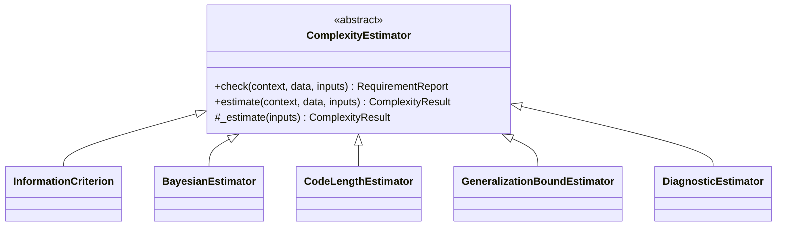
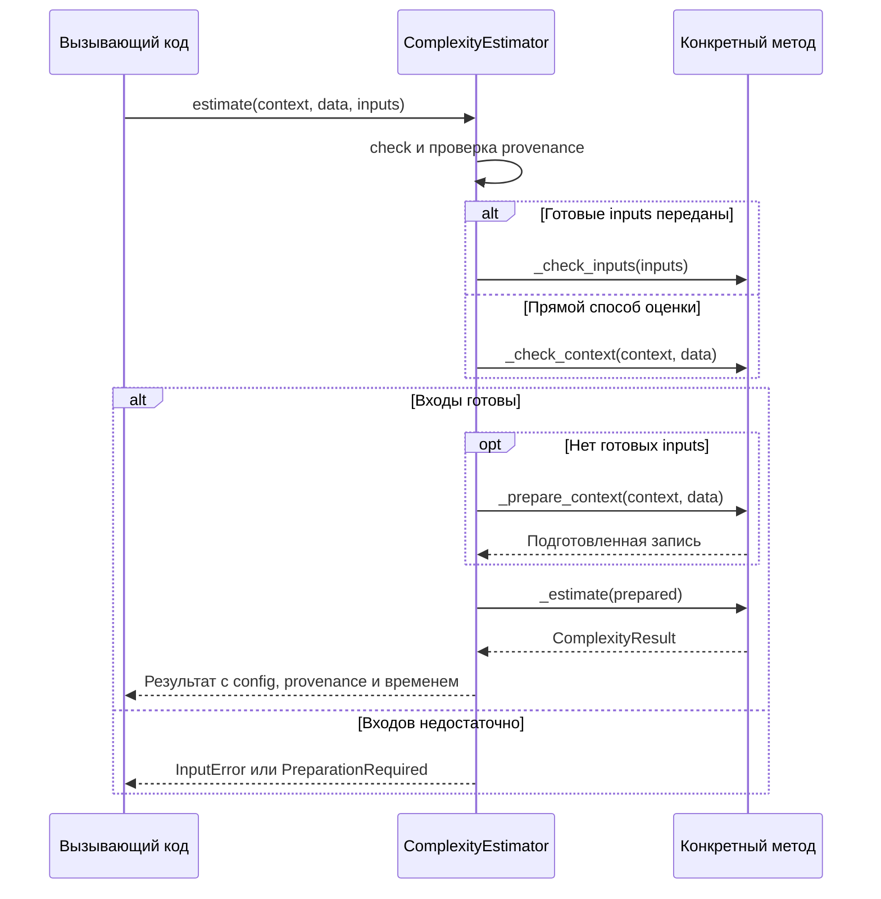

# Устройство пакета dl_complexity

_Карта модулей, базовых интерфейсов и вызовов._

---

## 🗂️ Модули

| Модуль | Ответственность | Основные объекты |
| --- | --- | --- |
| [base.py](base.py) | Проверка входов, выбор способа подготовки и выполнение оценки | `ComplexityEstimator` |
| [context.py](context.py) | Модель, объявленный likelihood, loss и рецепт обучения | `ModelContext`, `ModelStructure`, `TrainingRecipe`, `TrainingRecord` |
| [data.py](data.py) | Источник пар `(inputs, targets)` | `DataSource` |
| [results.py](results.py) | Значения с единицами, происхождение и статус готовности | `Quantity`, `ComplexityResult`, `Provenance`, `RequirementReport` |
| [evaluation.py](evaluation.py) | Последовательный вызов именованных оценщиков | `ComplexitySuite`, `EvaluationOutcome` |
| [errors.py](errors.py) | Ошибки входов и необходимость подготовки | `InputError`, `PreparationRequired` |
| [_validation.py](_validation.py) | Внутренняя проверка тензоров и целых чисел | `as_tensor`, `scalar`, `positive_int` |
| [criteria](criteria/README.md) | AIC, BIC, HQIC, WAIC | `InformationCriterion` |
| [bayesian](bayesian/README.md) | WBIC, отрицательный ELBO, Laplace/KFAC | `BayesianEstimator` |
| [coding](coding/README.md) | Двухчастная и последовательная длина кода | `CodeLengthEstimator` |
| [compression](compression/README.md) | Преобразования весов, кодек и Matrix-Project | `ModelTransform`, `ModelCodec` |
| [bounds](bounds/README.md) | Условная граница риска сжатого предиктора | `GeneralizationBoundEstimator` |
| [diagnostics](diagnostics/README.md) | Число параметров, нормы и разреженность | `DiagnosticEstimator` |
| [integrations/torch](integrations/torch/README.md) | Likelihood, подготовка статистик и явный запуск обучения | `prepare_fit_statistics`, `run_training` |

Публичные сигнатуры и параметры доступны в [справочнике](../../docs/API_REFERENCE.md).
Ниже `_check_*`, `_prepare_context` и `_estimate` описаны как точки расширения
класса. При использовании готового оценщика вызывать их напрямую не нужно.

## 🧩 Базовые интерфейсы

Семейные базы наследуют `ComplexityEstimator[TInputs]`. Они разделяют назначение
оценок, но не добавляют отдельного цикла `fit` или хранения обученной модели.

| Контракт | Возврат | Обязанность реализации |
| --- | --- | --- |
| `ComplexityEstimator.check(context=None, *, data=None, inputs=None)` | `RequirementReport` | Проверить доступность и согласованность входов без запуска модели |
| `ComplexityEstimator.estimate(context=None, *, data=None, inputs=None)` | `ComplexityResult` | Проверить запрос, подготовить разрешённый прямой вход и вычислить оценку |
| `ModelTransform.apply(model)` | Независимый `nn.Module` | Не менять исходную модель |
| `ModelCodec.encode(model)` | `EncodedModel` | Записать полное сообщение в выбранном кодовом языке |
| `ModelCodec.decode(encoded, model_factory=None)` | Восстановленный `nn.Module` | Восстановить предиктор из сообщения и общих правил декодера |

Преобразование весов само по себе не задаёт длину кода. `EncodedModel.length_bits`
равно `8 * len(payload)`, включая заголовок и дополнение до целых байтов.
Кодек и преобразование не наследуют `ComplexityEstimator`.

### Точки расширения оценщика

| Атрибут или метод | Когда переопределять | Контракт |
| --- | --- | --- |
| `input_type` | Всегда задаётся конкретным методом или его базой | Тип либо кортеж типов подготовленных входов |
| `_estimate(inputs)` | Обязательно, это абстрактный метод | Вернуть `ComplexityResult` с математически определёнными `kind`, quantities и единицами |
| `_check_inputs(inputs)` | Для проверки полей входной записи | Вернуть `RequirementReport`, не обучать и не запускать forward |
| `_check_context(context, data)` | Если есть прямой способ оценки модели | Проверить наличие модели, likelihood и данных без чтения итератора |
| `_prepare_context(context, data)` | Вместе с прямым способом оценки | Вернуть запись `input_type`, не выполнять скрытое обучение |
| `uses_data` | Установить `False`, если прямой способ не читает данные | Участвует в защите одноразового источника в `ComplexitySuite` |
| `__init__` | При наличии настроек | Передать фиксируемые настройки в `super().__init__(**config)` |

`config` возвращает неглубокую копию словаря. По умолчанию `_check_context`
сообщает `MISSING_INPUTS`, а `_prepare_context` поднимает `PreparationRequired`.
Базовый `_check_inputs` принимает запись нужного типа. Для нового метода
необходимые числовые ограничения следует добавить явно.

## 🔄 Порядок выполнения

Если передан `inputs`, модель и данные не используются для повторного расчёта
статистик. Однако непустые `state_id`, `data_id`, `likelihood_id` сопоставляются с
`inputs.provenance`, когда соответствующий контекст также передан. Несовпадение
вызывает `InputError`. Проверяется равенство объявленных идентификаторов, не хеши
тензоров или выборки.

`estimate` измеряет время после `check`. В него входят подготовка и формула,
но нет синхронизации CUDA/MPS. Это время вызова на стороне Python, не готовая
метрика для сравнения производительности методов.

## 📦 Данные, состояние и результат

| Объект | Поля или операции | Владение состоянием |
| --- | --- | --- |
| `ModelContext` | `model`, `loss`, `likelihood`, `training`, IDs, `runs` | Ссылается на исходную модель, не копирует и не обучает её при создании |
| `ModelContext.structure` | Список модулей и `ParameterInfo` | Заново обходит имена и формы, не читает значения весов и не строит forward-граф |
| `ParameterInfo` | `name`, `shape`, `trainable`, `alias_of` | Запись о ссылке на параметр, доступна через `structure.parameters` |
| `ModelContext.from_checkpoint` | Factory, загрузка обычного `state_dict`, строгая проверка | Нужны архитектура и совпадающий dtype. Factory создаёт новую модель |
| `DataSource` | `batches`, объявленные `n_observations`, `data_id` | Источник либо фабрика источника, чтение начинается при итерации |
| `DataSource.from_tensors` | Один batch из двух тензоров | Хранит ссылки, без разбиения на minibatches |
| `TrainingRecipe` | `train`, `objective`, `config` | Описание запуска, не результат обучения |
| `TrainingRecord` | Objective, config, seed, status, исходные IDs | Метаданные выполненного вызова, без обученной модели |
| `ComplexityResult` | `method`, `kind`, `quantities`, `primary_name`, `assumptions`, `config`, `provenance`, `elapsed_seconds` | Содержит значения и условия их интерпретации |
| `Quantity` | `value`, `unit`, `normalization` | Сохраняет Tensor и его autograd-связи |
| `RequirementReport` | `status`, `missing`, `actions`, `assumptions` | Свойство `ready` проверяет равенство статуса `READY` |

`Quantity.to` переводит только nats ↔ bits либо возвращает ту же единицу.
`per_observation(n)` делит total log/code/IC-величину на число наблюдений.
Границы риска так не нормируются. Основное значение доступно через
`result.primary`, компоненты — через `result.quantities`. У диагностик
`primary` может быть `None`. Общего поля `.score` и сортировки разных `kind` нет.

Frozen dataclass запрещает присваивание полю, но не изменение вложенного Tensor
или словаря. Подготовленные записи не следует менять между `check` и `estimate`.
Наличие готовых входов не подтверждает MLE/MAP, iid или сходимость сэмплера.

### Внутренняя проверка значений

| Функция | Проверка и результат | Затраты |
| --- | --- | --- |
| `as_tensor(value)` | Сохраняет floating Tensor. Для обычных чисел создаёт float64 Tensor. Целочисленный Tensor отклоняет | `O(1)` для готового Tensor, до `O(T)` для материализации значений |
| `scalar(value, name)` | Требует нульмерный конечный floating Tensor | `O(1)`, boolean-проверка может синхронизировать ускоритель |
| `positive_int(value, name)` | Требует положительный Python int, исключая bool | `O(1)` |

Это внутренние функции из `_validation.py`. Проверка конкретной формулы остаётся
в соответствующем модуле, например допустимость `n` у HQIC или положительность
собственных значений у Laplace.

## 🧮 Совместная оценка

`ComplexitySuite(methods, errors="raise" | "collect")` вызывает методы
последовательно в порядке словаря. Здесь `inputs` — словарь
`имя_метода → подготовленная запись`, в отличие от одного оценщика.

| Метод | Работа |
| --- | --- |
| `_validate_names(inputs)` | Отвергает входы для неизвестного имени метода |
| `check(...)` | Собирает `RequirementReport` каждого метода без вычисления оценок |
| `estimate(...)` | Проверяет все запросы, защищает одноразовый источник, затем вызывает готовые методы |

Возврат `suite.estimate` — словарь `EvaluationOutcome`. Каждый исход содержит
результат, сведения о недостающих входах или исключение. В режиме `collect`
ошибка одного метода не заменяется нулём и не скрывается. В режиме `raise`
заранее известная нехватка входов останавливает вызов до вычислений. Если ошибка
возникла уже во время исполнения, действия ранее выполненных методов не откатываются.

Несколько методов не могут независимо прочитать один одноразовый итератор.
`DataSource.one_shot` определяется структурно по наличию `__next__`, поэтому для
нестандартного iterable надёжнее передавать фабрику нового источника.
Одна `FitStatistics` может быть явно передана AIC, BIC и HQIC. Автоматического
общего кеша likelihood в suite нет.

## 🔌 Добавление метода

1. Выбрать семейную базу по смыслу результата, а не по удобству наследования.
2. Описать тип входов и реализовать `_estimate`. Для входной записи указать
   основание логарифма, форму, нормировку и происхождение статистик.
3. Реализовать проверки допустимости и вернуть условия применения в результате.
4. Если подготовка требует обучения, posterior или кривизны, вынести её в
   отдельную вызываемую функцию. Прямой маршрут оставить только там, где он
   поддерживается явно.
5. Добавить публичный экспорт в `__init__.py` нужного семейства и математический
   тест через `estimate` с независимо рассчитанным эталоном.

Конкретные примеры наследования находятся в [criteria](criteria/README.md),
а разделение подготовки и формулы — в [bayesian](bayesian/README.md) и
[coding/prequential](coding/prequential/README.md). Примеры численных проверок
собраны в [tests/README.md](../../tests/README.md).
