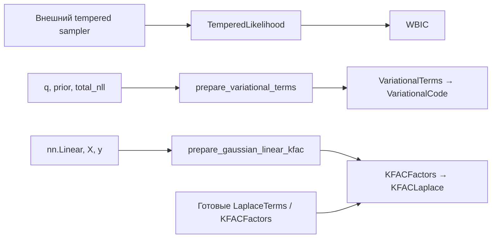

# Байесовские оценки

_Карта `dl_complexity.bayesian`: подготовленные ожидания, вариационные слагаемые и лапласовская аппроксимация evidence._

---

## 🧭 Состав модуля и базовый интерфейс

`WBIC`, `VariationalCode` и `KFACLaplace` наследуют [BayesianEstimator](base.py), который наследует [ComplexityEstimator](../base.py). Семейная база не добавляет обучение или сэмплирование. Публичный вызов оценщиков общий: `check(inputs=...)`, затем `estimate(inputs=...)`. Все три возвращают именованные величины в `nats` через [ComplexityResult](../results.py).

| Файл | Содержимое и видимость |
| --- | --- |
| [__init__.py](__init__.py), [base.py](base.py) | Публичные импорты и семейная база |
| [inputs.py](inputs.py) | Публичные `TemperedLikelihood`, `VariationalTerms`, `LaplaceTerms`, `KroneckerBlock`, `KFACFactors` |
| [wbic.py](wbic.py), [variational.py](variational.py), [laplace.py](laplace.py) | Конкретные оценщики. `_check_inputs` и `_estimate` — защищённые точки реализации |
| [preparation.py](preparation.py) | Публичные явные функции `prepare_variational_terms` и `prepare_gaussian_linear_kfac` |
| [_checks.py](_checks.py) | Внутренний `scalar_metadata`: проверка scalar shape/type. Имя функции без `_`, но модуль приватный и функция не экспортируется |
| [laplace.py](laplace.py) | Приватный `_psd_eigenvalues`: проверка и спектр PSD-фактора |

Frozen-записи входов сохраняют ссылки на Tensor. Их создание занимает `O(1)` по числу элементов и не подтверждает конечность значений или математические условия метода.

## 🔄 Подготовка отделена от оценки



Путь только через `ModelContext` для этих методов не реализован. Отчёт `check` указывает недостающий тип входа. Он не расходует RNG и не вычисляет спектры матриц. Для нескольких оценок подготовленный вход можно передать в [ComplexitySuite](../evaluation.py), сохранив отдельный результат каждого метода.

## 🌡️ WBIC: среднее при заданной температуре

`TemperedLikelihood` содержит вектор `[S]` полных log likelihood, число наблюдений `n > 1` и `beta = 1 / ln(n)`. Сэмплы должны происходить из распределения, пропорционального `prior(θ) · likelihood(D|θ)^beta`. Проверка `beta` использует `rel_tol=1e-6`, `abs_tol=1e-12`.

`WBIC._estimate` проверяет конечность вектора и возвращает `wbic = −mean(log_likelihood)`. Дополнительного множителя `beta` или `2` в формуле нет. Время `O(S)`, исходный вектор и его проверки занимают `O(S)` памяти. Конструктор и `_check_inputs` работают за `O(1)` по длине вектора.

Собственного sampler в модуле нет. Наличие корректной формы `[S]` не доказывает нужную стационарную меру или смешивание цепи. Обычный posterior при `beta=1` нельзя подставить вместо tempered posterior. WBIC используется как асимптотическое приближение free energy.

## 🧮 Вариационный код: сумма двух слагаемых

`VariationalTerms(expected_nll, kl_divergence, n=None, kl_estimator=...)` задаёт

$$
F_q=\mathbb{E}_{q(\theta)}[-\ln p(D\mid\theta)]
+\operatorname{KL}(q(\theta)\Vert p(\theta)).
$$

`VariationalCode` возвращает `negative_elbo` и отдельные `expected_nll`, `kl_divergence`. Все значения полные, в `nats`. Поле `n` сохраняется как метаданное и не делит сумму на число наблюдений. Отрицательный аналитический KL отклоняется. Для оценки Monte Carlo отрицательный результат возможен и не обрезается.

Публичная `prepare_variational_terms(q, prior, total_nll, ...)`:

1. Получает сразу `S=n_samples` сэмплов через `rsample`, если распределение поддерживает его, иначе через `sample`.
2. Вызывает `total_nll(theta)` отдельно для каждого сэмпла. Callable должен вернуть scalar NLL для всей выборки.
3. При `analytic_kl=True` вызывает зарегистрированный `torch.distributions.kl_divergence` и суммирует его компоненты. Отсутствующая формула вызывает ошибку, скрытого перехода на Monte Carlo нет.
4. При `analytic_kl=False` отдельно суммирует event/batch-компоненты `q.log_prob(theta)` и `prior.log_prob(theta)`, затем усредняет их разность.
5. Возвращает `VariationalTerms` с меткой способа оценки KL.

Работа — цена генерации сэмплов плюс `S` вызовов NLL и вычисление KL или log density. Для размерности сэмпла `d` хранится `O(Sd)` значений и `S` скаляров. При включённом autograd сохраняются графы вызовов NLL. Это не потоковый алгоритм. `rsample` сохраняет доступные pathwise gradients, а `sample` не добавляет score-function estimator.

У самого `VariationalCode._check_inputs` и `_estimate` скалярная работа `O(1)`. Это вычисление отрицательной ELBO по готовым слагаемым, без оптимизации `q` и без физического кодека.

## 📐 Laplace: logdet без полной Kronecker-матрицы

`LaplaceTerms` позволяет непосредственно передать `log_likelihood`, нормированный `log_prior`, размерность `d` и `logdet_precision`. `KFACLaplace` вычисляет

$$
-\ln p(D)\;\approx\;-\ell(\hat\theta)-\ln p(\hat\theta)
-\frac d2\ln(2\pi)+\frac12\ln\det H.
$$

Это скалярный путь `O(1)` после подготовки слагаемых. Константы плотности prior должны входить в `log_prior`. Применимость требует подходящей MAP-точки, положительной posterior precision и согласованного подпространства параметров.

У `KFACFactors` каждый `KroneckerBlock(A, G, scale=s)` задаёт likelihood precision `s · (G ⊗ A)`. Для изотропной prior precision `α > 0` спектр posterior-блока вычисляется как

$$
\lambda_{ij}=s\,\lambda_i(G)\lambda_j(A)+\alpha,
\qquad \ln\det H_b=\sum_{i,j}\ln\lambda_{ij}.
$$

Полная матрица размера `[ag, ag]` не строится. Слагаемое `αI` добавляется точно к выбранному Kronecker-блоку. Это не factorwise damping и не делает исходную KFAC-аппроксимацию точной для произвольной нейросети.

| Функция | Работа и ограничения |
| --- | --- |
| `KFACLaplace.__init__`, проверки `LaplaceTerms`, `scalar_metadata` | `O(1)`: настройки и scalar metadata. Конечность скаляров проверяется при оценке |
| `KFACLaplace._check_inputs` для `KFACFactors` | `O(B)` по числу блоков: формы, dtype/device и метаданные. Элементы матриц не сканируются |
| `_psd_eigenvalues(M, name)` | Для матрицы `[m,m]`: проверки `O(m²)`, `eigvalsh` порядка `O(m³)`, память `O(m²)`. Требуются finite и симметрия с численной погрешностью |
| `KFACLaplace._estimate` по факторам | `O(Σ(a³ + g³ + ag))`. Рабочие Tensor одного блока имеют размер `O(a² + g² + ag)`, autograd может удерживать данные нескольких блоков |
| `prepare_gaussian_linear_kfac` | Для `N` наблюдений, `p` входов с bias-координатой и `g` выходов: `O(Npg + Np² + g²)`, дополнительные массивы `O(Np + Ng + p² + g² + pg)` |

`_psd_eigenvalues` симметризует принятую матрицу и обрезает только малые отрицательные собственные значения в пределах допуска `100 · eps · max(1, maxabs(M))`. Существенная отрицательная кривизна вызывает ошибку. Это обработка roundoff, без подбора damping.

`prepare_gaussian_linear_kfac` поддерживает только точный встроенный класс `nn.Linear`, согласованные `X[N,p₀]`, `y[N,g]`, нормальный likelihood с известным `noise_std` и изотропный Gaussian prior. Он считает `A = X_augᵀX_aug/N`, `G = I/σ²`, `scale=N`, нормированные likelihood и prior. Для этой модели Hessian точен. Веса не подгоняются, MAP требуется обеспечить отдельно. Общего сборщика факторов для всех слоёв нейросети нет.

## 🧪 Минимальный вход и дальнейшее чтение

```python
import torch
from dl_complexity.bayesian import VariationalCode, VariationalTerms

terms = VariationalTerms(
    expected_nll=torch.tensor(12.0, dtype=torch.float64),
    kl_divergence=torch.tensor(2.5, dtype=torch.float64),
    n=10,
)
result = VariationalCode().estimate(inputs=terms)
assert result.primary.value.item() == 14.5
assert result.primary.unit == "nats"
```

Численные ограничения и эталоны: [test_bayesian.py](../../../tests/test_bayesian.py), [test_analytical_bayesian.py](../../../tests/test_analytical_bayesian.py). Последовательные выводы формул — в [CODE_WALKTHROUGH](../../../docs/CODE_WALKTHROUGH.md#sb-bayesian), сигнатуры — в [API_REFERENCE](../../../docs/API_REFERENCE.md#reference-bayesian).

Tensor-операции сохраняют доступный autograd и исходный floating dtype/device. Проверки конечности и извлечение scalar могут синхронизировать GPU. Для интерпретации непрерывных плотностей как реальных длин кода отдельно нужны соглашения о точности. Скаляр в `nats` сам по себе не задаёт способ сериализации модели или данных.
