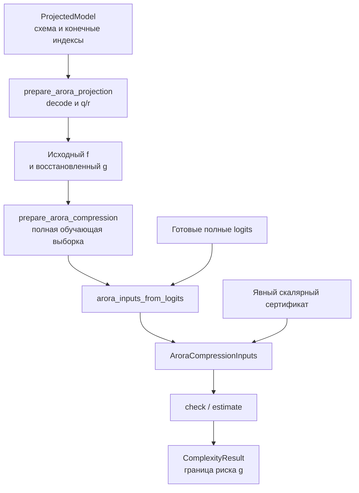

# `bounds`: условная граница риска Arora

_Карта сертификата сжатого предиктора, подготовки и проверки условий._

---

`AroraCompressionBound` оценивает риск **сжатого предиктора `g`** при заданной конечной параметризации и измеренном искажении относительно исходного `f`. Он не преобразует MDL в вероятность и не переносит гарантию на исходную сеть. Реализована условная Theorem 2.1 с явным `delta` из доказательства, а не полная noise-stability Theorem 4.1.

## 🗂️ Файлы и общий интерфейс

| Файл | Объекты | Роль |
| --- | --- | --- |
| [`base.py`](base.py) | `GeneralizationBoundEstimator[T]` | Семейная база над [`ComplexityEstimator[T]`](../base.py) |
| [`inputs.py`](inputs.py) | `AroraCompressionInputs` | Скалярный сертификат, конечный бюджет и объявленные условия |
| [`compression.py`](compression.py) | `AroraCompressionBound` | Проверки и формула границы |
| [`compression.py`](compression.py) | `arora_inputs_from_logits` | Сертификат по полным logits двух предикторов |
| [`compression.py`](compression.py) | `prepare_arora_compression` | Явное вычисление logits на всей обучающей выборке |
| [`compression.py`](compression.py) | `prepare_arora_projection` | Декодирование настоящего `ProjectedModel`, получение `q/r` и сертификата |
| [`__init__.py`](__init__.py) | Публичные экспорты | Перечисленные выше имена |

Иерархия: `ComplexityEstimator[AroraCompressionInputs] → GeneralizationBoundEstimator[AroraCompressionInputs] → AroraCompressionBound`. Семейная база не меняет lifecycle. Публичные `check` и `estimate` принимают `inputs=...`. Защищённые `_check_inputs` и `_estimate` реализуют условия и формулу, а `_validate` — приватная общая проверка скалярного сертификата.

Конструктор хранит `delta`, но не сжимает сеть. `check` не запускает forward, однако здесь он проверяет численные скалярные значения, а не только формы. Подготовка всегда вызывается отдельно.

## 🔄 Подготовка сертификата

| Входной путь | Откуда берутся значения | Что остаётся внешним условием |
| --- | --- | --- |
| `AroraCompressionInputs(...)` | Пользователь передаёт margin loss, максимум ошибки и бюджет | Корректность всей сводки, охват выборки и независимость конечной семьи |
| `arora_inputs_from_logits(f_logits, g_logits, targets, ...)` | Loss и искажение вычисляются по переданным `[n, C]` | Принадлежность logits нужным моделям, полнота выборки, фиксированные `q/r` |
| `prepare_arora_compression(f, g, data, ...)` | Два forward на всей `data`, затем предыдущая функция | Конечная параметризация `g`, независимость helper, decoder, alphabet и бюджета |
| `prepare_arora_projection(f, projected, data, ...)` | Чистый `g` декодируется из индексов, `q/r` берутся из артефакта | Независимость выбранной семьи и helpers от обучающей выборки |

Последний путь связан с [`AroraMatrixProject.project`](../compression/arora.py), а не с произвольным числом байтов checkpoint. `prepare_arora_projection` проверяет тип и полноту артефакта и вызывает `ProjectedModel.decode()`. В forward сжатой модели не используется произвольно изменённый instance `forward` из переданного контейнера.

## 📐 Что вычисляется

Пусть `n` — размер iid-выборки, `C` — число классов, `gamma > 0` — порог margin, `q` — заранее фиксированное число конечных координат, каждая из которых принимает не более `r` значений. В контексте фиксированного декодера такая семья содержит не более `r^q` предикторов.

Сертификат использует margin исходного предиктора и максимальное покоординатное искажение:

$$
m_f(x,y)=f_y(x)-\max_{j\ne y}f_j(x),\qquad
\widehat L_\gamma(f)=\frac1n\sum_i \mathbf 1\{m_f(x_i,y_i)\le\gamma\},
$$

$$
\varepsilon=\max_{i,j}|f_j(x_i)-g_j(x_i)|\le\frac\gamma2.
$$

Порог `gamma/2` нужен из-за двух логитов: margin может измениться на `2 * epsilon`. Если исходный margin строго больше `gamma`, знак margin сжатой модели сохраняется. Равенство порогу и ties считаются margin-ошибками.

Оценщик вычисляет явную Hoeffding/union-bound форму доказательства Theorem 2.1:

$$
\widehat L_\gamma(f)
+\sqrt{\frac{q\ln r-\ln\delta}{2n}}.
$$

`q` — не число плотных весов и не число ненулевых параметров. `r` — не свободно подобранное после обучения число уровней. Обученные codebook, масштабы, support indices и прочие сведения декодера должны быть учтены в допустимой конечной семье. `EncodedModel.length_bits` не определяет `q/r` автоматически.

## 📋 Проверки и смысл результата

`AroraCompressionInputs` хранит `empirical_margin_loss`, `n_observations`, `parameter_count`, `values_per_parameter`, `margin`, `max_logit_error`, два флага независимости, `certificate_kind`, идентификатор `g` и provenance. Создание записи занимает `O(1)` и не доказывает значения её полей.

`_validate` требует `n > 0`, целые `q >= 0`, `r >= 1`, конечный положительный margin, margin loss в `[0,1]` и конечное искажение в `[0, gamma/2]`. Два independence-флага должны иметь тип `bool`. `_check_inputs` возвращает отсутствие необходимых условий, если один из флагов ложен. Значение `True` — заявление вызывающей стороны, не статистический тест независимости.

| Величина результата | Содержание | Единицы |
| --- | --- | --- |
| `risk_upper_bound` | Margin loss плюс штраф, основная величина | `probability` |
| `empirical_margin_loss` | Измеренная доля margin-ошибок `f` | `probability` |
| `complexity_penalty` | Квадратный корень из формулы | `probability` |
| `log_cardinality_upper_bound` | `q * ln(r)` | `nats` |
| `max_logit_error` | Измеренное покоординатное искажение | `dimensionless` |

`risk_upper_bound` возвращается без clipping и может быть больше единицы. Тогда численная граница неинформативна. Её нельзя переводить в биты вместе с логарифмом мощности семьи. В `assumptions` явно записаны iid, независимость конечной семьи, полный sample certificate и то, что гарантия относится к `g`.

### Область реализованного варианта

Matrix-Project реализует Algorithm 1 с конечным алфавитом коэффициентов. Для настоящего артефакта допускается узкая схема встроенных bias-free MLP, описанная в [`compression`](../compression/README.md). Отдельный `prepare_arora_compression` принимает обычные tensor-input классификаторы, но переданные `q/r` для них остаются внешним обоснованием.

Полная Theorem 4.1 требует дополнительных конструкций и условий noise stability. Layer/interlayer cushions, `rho_delta`, геометрический выбор бюджета и соответствующий полный алгоритм сжатия здесь не реализованы. `nominal_projection_count` и низкая ошибка на выборке не заменяют эти компоненты.

## ⏱️ Вычисления и память

`arora_inputs_from_logits` требует конечные logits одной формы `[n, C]`, dtype и device, а также допустимые целочисленные targets `[n]`. В `no_grad` она выбирает true-class logits, создаёт копию конкурентов с `-inf` на true class, вычисляет margins, долю ошибок и `max(abs(f-g))`. Итоговые скаляры не сохраняют граф.

`prepare_arora_compression` копирует обе модели, включает eval и `inference_mode`, обходит данные и сохраняет logits всех батчей в списках. После обхода выполняется конкатенация. Измерение максимума не сворачивается в потоковый скаляр на каждом батче. Объявленное `data.n_observations`, если оно есть, сверяется с фактическим числом меток.

Подготовка изолирует CPU RNG и CUDA RNG устройств параметров моделей. Это не универсальная изоляция внешних Python-эффектов или RNG на устройствах, которых нет среди параметров. Входы и class-index targets пока должны быть тензорами.

| Вызов | Время | Дополнительная память |
| --- | --- | --- |
| `AroraCompressionInputs`, конструктор оценщика | `O(1)` | `O(1)` ссылок и скаляров |
| `_validate`, `_check_inputs`, `_estimate` | `O(1)` без forward | `O(1)`, скалярные GPU-проверки могут синхронизировать устройство |
| `arora_inputs_from_logits` | `O(nC)` | `O(nC)` для конкурентов, масок и разностей |
| `prepare_arora_compression` | Два forward на всей выборке и `O(nC)` для сертификата | Копии моделей `O(P_f + P_g)`, накопленные logits `O(nC)` и временные конкатенации |
| `prepare_arora_projection` | Предыдущая строка плюс проверка и decode проекций | Дополнительно helpers, реконструкции и свежий `g` |

Для проекции матрицы с `P` элементами и `K` helpers проверка и реконструкция требуют `O(KP)` работы и промежуточного произведения. Это отдельная стоимость от скалярного расчёта границы. Источник формул и точная конфигурация theorem/margin находятся в [`compression.py`](compression.py).
