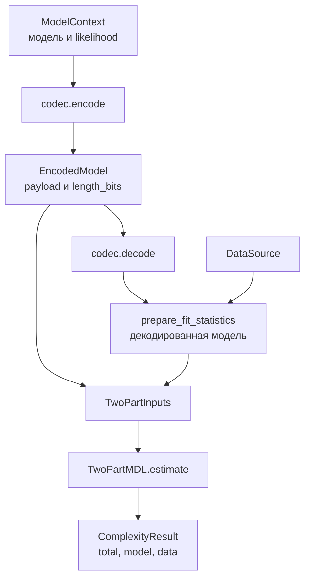

# `coding`: длины описания

_Карта модулей, входных объектов и вычислений кодовых оценщиков._

---

`coding` складывает явно подготовленные кодовые стоимости. `TwoPartMDL` описывает модель и данные при декодированной модели. Prequential-оценщики описывают метки последовательностью предсказаний, сделанных до обучения на этих метках. Оба пути возвращают `ComplexityResult` в `nats` или `bits`, но отвечают на разные вопросы.

## 🗂️ Файлы и границы интерфейса

| Файл | Ответственность | Доступные объекты |
| --- | --- | --- |
| [`base.py`](base.py) | База семейства кодовых оценок | `CodeLengthEstimator` |
| [`inputs.py`](inputs.py) | Записи с достаточными входными данными | `TwoPartInputs`, `PrequentialEntry`, `PrequentialLedger` |
| [`two_part.py`](two_part.py) | Формула двухчастного кода и явная подготовка | `TwoPartMDL`, `prepare_two_part` |
| [`prequential/`](prequential/README.md) | Причинные протоколы, журнал и калибровка | Три оценщика, три `prepare_*`, `TemperatureScaler` |
| [`__init__.py`](__init__.py) | Публичные импорты семейства | Перечисленные выше имена |

Иерархия оценщиков имеет вид `ComplexityEstimator[T] → CodeLengthEstimator[T] → TwoPartMDL` либо `PrequentialEstimator → BlockwisePrequential / OnlinePrequential / ReplayPrequential`. Общие `check` и `estimate` находятся в [`../base.py`](../base.py). `CodeLengthEstimator` добавляет смысловую границу семейства, но не меняет вычислительный протокол.

`_check_inputs` и `_estimate` — защищённые точки расширения оценщика, а не альтернативные пользовательские входы. `prepare_two_part` — отдельная публичная функция. Вызов `estimate(inputs=...)` не запускает кодек и не оценивает сеть заново.

## 🔄 Путь от модели до результата

[`prepare_two_part`](two_part.py) выполняет пять действий:

1. Вызывает `codec.encode(context.model)`. Длина модели берётся из фактического сообщения `EncodedModel.length_bits`.
2. Вызывает `codec.decode(...)`. При необходимости проверяет переданный `model_factory` средствами кодека.
3. Переносит декодированную модель на устройство первого параметра исходной модели. Исходные `dtype` параметров сохраняются.
4. Создаёт заменённый `ModelContext` с декодированной моделью и без прежнего `state_id`.
5. Вызывает [`prepare_fit_statistics`](../integrations/torch/likelihood.py) и возвращает `TwoPartInputs(model_bits, -log_likelihood, n, ...)`.

Это связывает данные с тем предиктором, который действительно восстанавливается из сообщения. Подставлять NLL исходной модели после lossy-квантования или усечения ранга нельзя: получился бы код модели `g` и данных при другой модели `f`.

## 📐 Входы и расчёт `TwoPartMDL`

`TwoPartInputs` — frozen dataclass. Она сохраняет ссылки на значения, но не кодирует модель, не считает likelihood и не делает вложенные тензоры неизменяемыми.

| Поле | Смысл и единицы |
| --- | --- |
| `model_bits` | Полная неотрицательная стоимость модели в битах, включая сведения для декодера |
| `data_nll` | Суммарный NLL декодированной модели в натах |
| `n` | Число наблюдений, не число батчей |
| `data_code_convention` | `discrete` либо `quantized` |
| `resolution_adjustment_nats` | Для плотности: отрицательный суммарный логарифм объёма ячеек |
| `provenance` | Объявленные идентификаторы состояния, данных и likelihood |

Для вывода в натах оценщик вычисляет

$$
L_{\mathrm{model}} = B_{\mathrm{model}}\ln 2,\qquad
L_{\mathrm{data}} = -\ln p_g(D) + c,\qquad
L_{\mathrm{total}} = L_{\mathrm{model}} + L_{\mathrm{data}}.
$$

При `unit="bits"` обе составляющие делятся на $\ln 2$. Результат содержит `total`, `model`, `data` и `per_observation = total / n`. Основная величина — `total`.

Для `discrete` поправка `c` обязана быть нулевой, а код данных — неотрицательным. Для непрерывной плотности требуется `quantized` с явной поправкой $c=-\sum_i\ln\Delta V_i$. Приближение $p_g(x_i)\Delta V_i$ не равно точному интегралу вероятности ячейки, поэтому результат помечается `two_part_density_code_approximation`. Отрицательный density NLL сам по себе не принимается за кодовую длину.

### Проверки и дифференцируемость

- `check(inputs=...)` проверяет тип записи, `n`, скалярные формы и название конвенции. Конечность чисел и неотрицательность стоимости проверяются при вычислении.
- `estimate(inputs=...)` использует формулу без forward. Переданные скалярные тензоры могут сохранять autograd-связи.
- `prepare_two_part` проходит через дискретное сообщение. Градиенты не проходят сквозь `encode/decode` к исходным весам.
- `check` не доказывает полноту произвольного пользовательского кода и не подтверждает происхождение переданного NLL.

## 🧩 Связи с остальными модулями

| Нужная операция | Компонент |
| --- | --- |
| Изменить веса без изменения исходной модели | [`ModelTransform`](../compression/base.py) и его реализации |
| Получить реальное сообщение и восстановить модель | [`ModelCodec`, `BinaryModelCodec`](../compression/README.md) |
| Вычислить данные при явном likelihood | [`ModelContext`](../context.py), [`DataSource`](../data.py), `prepare_fit_statistics` |
| Описать последовательность обучения | [`PrequentialLedger` и `prepare_*`](prequential/README.md) |
| Получить границу риска по конечной семье | [`bounds`](../bounds/README.md), не пересчёт MDL в вероятность |

Ни число ненулевых весов, ни выбранный ранг, ни размер `state_dict` без схемы декодирования не заменяют `model_bits`. `BinaryModelCodec` считает собственный заголовок, архитектуру, формы, типы и содержимое тензоров. Это длина конкретного формата, а не минимальная возможная длина описания сети.

## ⏱️ Вычислительная стоимость

Здесь и в соседних картах асимптотика получена из операций кода, а не из измерения времени. Пусть `P` — число хранимых параметров и буферов, `M` — размер бинарного сообщения, `F(D)` — стоимость forward на данных.

| Вызов | Время | Дополнительная память |
| --- | --- | --- |
| `TwoPartInputs(...)` | `O(1)` | `O(1)` ссылок |
| `TwoPartMDL(...)`, `_check_inputs`, `_estimate` | `O(1)` | `O(1)` скалярных объектов |
| `prepare_two_part(...)` | Encode + decode + `F(D)` и likelihood | Сообщение `O(M)`, декодированная модель и изолирующие копии порядка `O(P)`, рабочая память forward |
| `PrequentialEntry`, `PrequentialLedger` | Создание обёрток `O(1)` | Сами записи удерживают журнал `O(B + R_total)` |

Стоимость кодека зависит от выбранного режима. В частности, SVD и текущая Python-упаковка битов не имеют той же стоимости, что простое копирование тензора. Подробности находятся в [карте `compression`](../compression/README.md).
