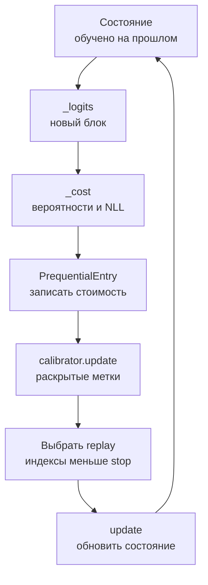

# `prequential`: кодирование по истории предсказаний

_Карта протоколов, журнала и калибровки вероятностей._

---

Prequential-код складывает стоимости меток в том порядке, в котором они становятся известны обучающему алгоритму. Для блока `[start, stop)` сначала вычисляются вероятности и NLL, затем раскрываются метки и обновляется состояние. Последний checkpoint не содержит этой истории, поэтому одного checkpoint для prequential-оценки недостаточно.

## 🗂️ Файлы и наследование

| Файл | Класс или функции | Роль |
| --- | --- | --- |
| [`base.py`](base.py) | `PrequentialEstimator` | Проверяет журнал и суммирует кодовые стоимости |
| [`blockwise.py`](blockwise.py) | `BlockwisePrequential` | Выбирает `protocol="blockwise"` |
| [`online.py`](online.py) | `OnlinePrequential` | Выбирает `protocol="online"` |
| [`replay.py`](replay.py) | `ReplayPrequential` | Выбирает `protocol="replay"` |
| [`protocol.py`](protocol.py) | `prepare_blockwise`, `prepare_online`, `prepare_replay` | Явно выполняют обучение и записывают историю |
| [`calibration.py`](calibration.py) | `TemperatureScaler` | Меняет вероятности через одну положительную температуру |
| [`../inputs.py`](../inputs.py) | `PrequentialEntry`, `PrequentialLedger` | Отделяют подготовку от оценщика |

Иерархия: [`ComplexityEstimator`](../../base.py) → [`CodeLengthEstimator`](../base.py) → `PrequentialEstimator` → три класса протоколов. Три конечных класса не дублируют расчёт: различается значение `protocol`, а проверки и сумма находятся в общей базе. `PrequentialEstimator` — внутренняя база семейства, не экспортируемая через [`__init__.py`](__init__.py).

`check` и `estimate` — публичный общий интерфейс. Методы `_check_context`, `_check_inputs`, `_validate_metadata` и `_estimate` относятся к реализации оценщика. Они не обучают модель. Без журнала обращение через контекст сообщает о необходимости явной подготовки.

## 🔄 Порядок одного онлайн-шага

Калибровка и replay на схеме необязательны. Если они заданы, их результаты могут повлиять только на последующие предсказания. Метки текущего блока разрешены в replay **после** записи его стоимости.

## 🧩 Три подготовительных протокола

Входы — материализованные тензоры `x` и целочисленные метки `y: [n]`. `n_classes >= 2`, предсказание должно возвращать конечные logits `[batch, n_classes]`. `model_factory()` создаёт состояние. Это может быть `nn.Module` или пользовательский объект с моделью и оптимизатором. Для второго случая передаётся `predict_logits(state, batch)`.

| Функция | Состояние и callback | Что разрешено перед оценкой блока |
| --- | --- | --- |
| `prepare_blockwise(..., boundaries, train, ...)` | Для каждого следующего блока создаётся новое состояние. `train(state, x_prefix, y_prefix)` получает весь прошлый префикс | Обучение только на `[:start]`. При заданном `calibrator_factory` свежий калибратор подгоняется на прошлом префиксе |
| `prepare_online(..., update, batch_size=1, ...)` | Одно состояние. `update(state, new_x, new_y)` вызывается после оценки нового блока | Накопленные предыдущие обновления. Начальный префикс обновляет модель только после оплаты начального кода |
| `prepare_replay(..., update, replay_size, ...)` | Одно состояние. `update(state, new_x, new_y, replay_x, replay_y)` | Как в online. Replay выбирается после текущей оценки и влияет на будущее |

Callback может вернуть новое состояние. При возврате `None` используется прежнее состояние с изменениями, внесёнными callback. Модуль не выбирает оптимизатор, число эпох или objective за пользователя.

`boundaries` в blockwise — возрастающие исключающие правые границы, последняя равна `n`. Первый блок оплачивается начальным кодом, по умолчанию `count * ln(n_classes)`. В online/replay размер начального блока задаётся `initial_count`, по умолчанию `0`. Собственный `initial_code` — суммарная стоимость этого префикса в натах, а не средний loss.

### Replay и его память

По умолчанию `prepare_replay` создаёт локальный CPU-генератор с `seed` и выбирает без возвращения до `replay_size` индексов из `[0, stop)`. Вызов `torch.randperm(stop)` строит перестановку всего доступного префикса, даже если нужен один replay-объект. Пользовательская `replay_policy(stop)` может выбирать иначе, но её индексы также проверяются на принадлежность раскрытому префиксу.

Реализация удерживает исходные `x/y` и записывает все replay-индексы в журнал. Это воспроизводимый протокол на материализованных данных, а не потоковый буфер с памятью, ограниченной одним `replay_size`.

## 📋 Что хранится и что проверяется

`PrequentialEntry` содержит `[start, stop)`, суммарный `nll`, `trained_until`, `calibrated_until` и `replay_indices`. Префиксные границы исключающие: `trained_until == start` означает, что метка с индексом `start` ещё не использована. `PrequentialLedger` хранит `initial_nll`, `initial_count`, tuple записей, полное `n`, название протокола и provenance.

Защищённый `_validate_metadata` проверяет:

- совпадение протокола и полное покрытие `[0, n)` начальным кодом и непересекающимися последовательными блоками
- целочисленность границ, отсутствие пропусков и повторного кодирования
- `trained_until <= start` и `calibrated_until <= start`
- replay только в replay-протоколе и индексы `0 <= index < stop`
- скалярную форму стоимости каждого блока

`_estimate` дополнительно проверяет конечные неотрицательные стоимости, а для пустого начального блока требует нулевой начальный код. Затем вычисляет

$$
L = L_{\mathrm{initial}} + \sum_j L_j,\qquad
L_j = -\sum_{i=s_j}^{t_j-1}\ln p_{\theta_j}(y_i\mid x_i).
$$

Результат содержит полную стоимость, начальную и последующую части, а также стоимость на наблюдение. Журнал хранит скаляры в натах, `unit="bits"` меняет только итоговое основание логарифма.

Проверка границ не доказывает причинность произвольного callback. Callback может читать скрытую метку из замыкания или глобальной переменной. `prepare_blockwise` обнаруживает повторное использование живого `nn.Module` вместо свежей фабрики, но не может полностью проверить произвольное пользовательское состояние.

## 🌡️ Калибратор и внутренние функции

`TemperatureScaler(temperature=1, steps=30, learning_rate=0.05)` хранит положительное `T`. `log_probs(logits)` возвращает `log_softmax(logits / T)`. `update(logits, targets)`, он же `fit`, отсоединяет logits и оптимизирует один `log(T)` по cross-entropy. Новый Adam создаётся при каждом обновлении. Веса нейросети от этого вызова не обучаются.

В online/replay калибратор применяется до оценки блока, затем обновляется по уже раскрытым logits и меткам. В blockwise фабрика создаёт калибратор для прошлого префикса. Вне этих подготовительных функций соблюдение порядка остаётся обязанностью вызывающего кода.

| Внутренняя функция в `protocol.py` | Вычисление и границы |
| --- | --- |
| `_sequence` | Проверяет согласованность осей, тип и диапазон меток, число классов |
| `_logits` | Вызывает callback либо модель, проверяет `[batch, C]`, конечность и отсоединяет выход. Для `nn.Module` включает eval и `no_grad`, затем восстанавливает флаги `training` всех модулей |
| `_cost` | Применяет `log_softmax` либо `calibrator.log_probs`, проверяет нормировку, выбирает вероятности целевых классов и суммирует отрицательные логарифмы |
| `_initial_cost` | Возвращает явный начальный код либо равномерный код `count * ln(C)` |
| `_prepare_stream` | Общий цикл online/replay: оценка, запись, калибровка, выбор replay, обновление |

`_logits` восстанавливает режимы модулей, но не произвольные изменения буферов, Python-состояния или RNG внутри пользовательского callback. Протокол не собирает архив активаций и градиентов. Производные при обучении создаёт сам callback.

## ⏱️ Стоимость и точки расширения

Обозначения: `B` — число оцениваемых блоков, `C` — число классов, `R_total` — суммарное число сохранённых replay-индексов, `F(b)` — forward для блока размера `b`, `A` — число шагов калибровки.

| Компонент | Время | Память сверх исходных данных |
| --- | --- | --- |
| `_sequence` | `O(n)` | До `O(n)` проверочных масок |
| `_logits`, `_cost` | `F(b) + O(bC)` | Logits и нормированные вероятности `O(bC)` плюс рабочая память forward |
| `_initial_cost` | `O(1)` | `O(1)` |
| `_validate_metadata`, `_check_inputs` | `O(B + R_total)` | `O(1)` обхода |
| `_estimate` | `O(B + R_total)` | `O(B)` для стека скалярных стоимостей |
| `TemperatureScaler.log_probs` | `O(bC)` | `O(bC)` |
| `TemperatureScaler.update` | `O(A bC)` | `O(bC)` и `O(1)` состояния скалярного оптимизатора |
| `prepare_online` | Обучение callback + forward и `O(nC)` операций вероятностей | Состояние обучения, текущий блок и журнал `O(B)` |
| `prepare_replay` | Online + стоимость выборки и replay-обучения | Журнал `O(B + R_total)`, перестановка `O(stop)` и копии выбранных данных |
| `prepare_blockwise` | Сумма обучения на префиксах, forward блоков и при калибровке forward префиксов | Текущее состояние, журнал `O(B)`, logits текущей операции |

Суммарная генерация replay-перестановок может стоить `O(n² / batch_size)`. В blockwise проверка слабых ссылок на фабричные модули обычно мала, но при удержании пользователем всех прошлых моделей её суммарный обход может достигать `O(B²)`. Срезы префикса сами по себе являются views, а не копиями всей истории.

Для нового способа обучения достаточно собственного состояния, фабрики, callback и, при необходимости, `predict_logits`. Для новой математической схемы журнала нужен отдельный контракт протокола, а не переименование `ReplayPrequential` или ослабление префиксных проверок.
