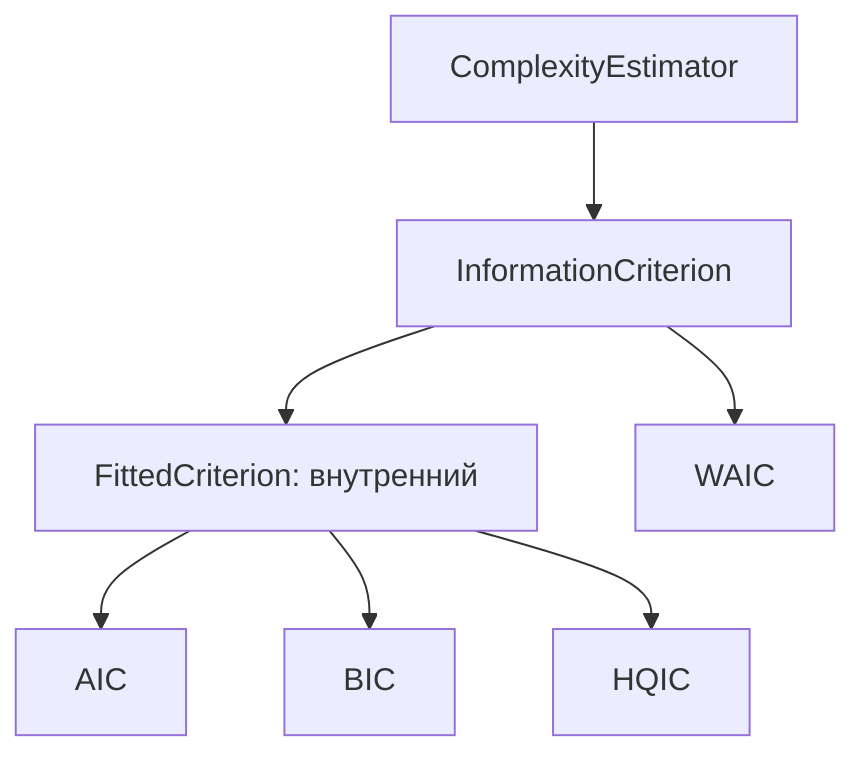
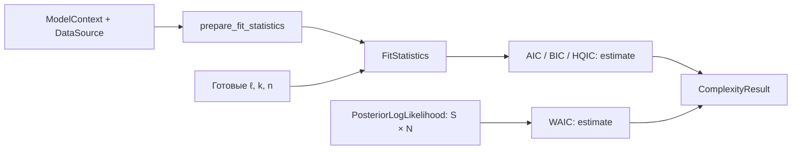

# Информационные критерии

_Карта модуля `dl_complexity.criteria`: достаточные входы, общие адаптеры и вычисления AIC, BIC, HQIC, WAIC._

---

## 🧭 Назначение и границы API

Модуль возвращает информационные критерии в исходной шкале `native_ic`. Значение критерия и его составляющие хранятся в [ComplexityResult](../results.py). Деление результата на два или перевод в bits автоматически не выполняются.

Публичные имена перечислены в [__init__.py](__init__.py): `AIC`, `BIC`, `HQIC`, `WAIC`, `InformationCriterion`, `FitStatistics`, `PosteriorLogLikelihood`. Пользователь вызывает у оценщика унаследованные `check(...)`, `estimate(...)` и свойство `config` из [ComplexityEstimator](../base.py). Методы с начальным `_` служат реализации семейства.

| Файл | Ответственность |
| --- | --- |
| [base.py](base.py) | `InformationCriterion`: семейная база без собственной формулы |
| [_fitted.py](_fitted.py) | Внутренний `FittedCriterion`: проверка fit-статистик и прямой путь через PyTorch likelihood |
| [inputs.py](inputs.py) | Две независимые записи входов: fit-статистики и posterior pointwise likelihood |
| [aic.py](aic.py), [bic.py](bic.py), [hqic.py](hqic.py) | Скалярные формулы и состав результата |
| [waic.py](waic.py) | Стабильная агрегация posterior likelihood по сэмплам и наблюдениям |

## 🧩 Наследование и входы



`FitStatistics(log_likelihood, k, n=None, provenance=None)` хранит полное натуральное log likelihood `ℓ`, число оцениваемых параметров `k` и число наблюдений `n`. Это значения для уже выбранного состояния модели. Регуляризатор в `ℓ` не входит. Для AIC `n` необязательно, для BIC требуется `n ≥ 1`, для HQIC — `n > 1`.

`PosteriorLogLikelihood(log_likelihood, provenance=None)` содержит floating Tensor формы `[S, N]`. Строка соответствует сэмплу из обычного posterior, столбец — наблюдению. Event-координаты одного наблюдения должны быть уже просуммированы. Требуются `S ≥ 2`, `N ≥ 1`.

Обе записи — frozen dataclasses. Конструктор сохраняет ссылки за `O(1)` по объёму Tensor, без копирования его значений. Frozen запрещает переназначение поля, но не изменение самого Tensor. `provenance` содержит объявленные ID, а не вычисленные контрольные суммы.

## 🔄 Два пути вычисления



Общий `estimate` сначала вызывает `check`. При готовом `inputs` forward не выполняется. При `estimate(context, data=...)` методы AIC/BIC/HQIC вызывают `_prepare_context`, который делегирует [prepare_fit_statistics](../integrations/torch/likelihood.py). Адаптер изолированно вычисляет likelihood текущих весов, но не обучает модель.

`parameter_count="trainable"` по умолчанию считает элементы уникальных `Parameter` с `requires_grad=True`. Режим `"all"` включает замороженные параметры. Можно передать явный целый `k`. Настройка относится к пути через контекст. У готового `FitStatistics` используется его собственный `k`.

Проверка метаданных не читает датасет и не доказывает, что веса найдены методом MLE. Несовместимые объявленные ID контекста, данных и готового входа отклоняются общей базой. Отсутствующий ID означает неизвестную идентичность.

## 🧮 Формулы и вычислительная работа

Время ниже — оценка по операциям кода, без инженерных замеров. Для готовых fit-статистик формулы скалярные:

| Метод | Формула | Именованные величины |
| --- | --- | --- |
| AIC | `−2ℓ + 2k` | `aic`, `deviance`, `penalty` |
| BIC | `−2ℓ + k ln n` | `bic`, `deviance`, `penalty` |
| HQIC | `−2ℓ + 2k ln ln n` | `hqic`, `deviance`, `penalty` |

Все величины этих трёх методов имеют единицу `native_ic` и полную нормировку. У HQIC штраф при `n=2` отрицателен: реализация следует формуле и не обрезает его до нуля.

WAIC использует поправку WAIC2 с выборочной дисперсией (`correction=1`):

$$
\mathrm{lppd}=\sum_{i=1}^{N}\left[\operatorname{logsumexp}_{s=1}^{S}\ell_{si}-\ln S\right],
\qquad p_{\mathrm{WAIC}}=\sum_{i=1}^{N}\operatorname{Var}_{s}(\ell_{si}),
$$

$$
\mathrm{elpd}_{\mathrm{WAIC}}=\mathrm{lppd}-p_{\mathrm{WAIC}},
\qquad \mathrm{WAIC}=-2\,\mathrm{elpd}_{\mathrm{WAIC}}.
$$

`waic` имеет единицу `native_ic`, `lppd` и `elpd_waic` — `nats`, `p_waic` — `dimensionless`. Точные ключи результата заданы в [waic.py](waic.py).

| Функции и операции | Работа и дополнительная память |
| --- | --- |
| Конструкторы оценщиков, `FittedCriterion._check_inputs`, `_check_context`, `_statistics`, `HQIC._check_inputs` | `O(1)` по размеру данных. `_statistics` проверяет конечность скаляра, что может синхронизировать GPU |
| `AIC._estimate`, `BIC._estimate`, `HQIC._estimate` | `O(1)` времени и Tensor-памяти после подготовки `ℓ, k, n` |
| `WAIC._check_inputs` | `O(1)`: dtype, форма и размеры осей, без проверки каждого элемента |
| `WAIC._estimate` | `O(SN)` времени для finite scan, `logsumexp` и дисперсий. Вход занимает `O(SN)`, промежуточные значения и autograd могут требовать ещё `O(SN)` |
| `FittedCriterion._prepare_context` | Цена [PyTorch-адаптера](../integrations/torch/README.md): копия модели, forward по всем данным и вычисление likelihood |

Существующие floating Tensor сохраняют dtype, device и autograd. Преобразования к Python во время проверки могут синхронизировать accelerator. Общая обёртка добавляет копирование небольшой конфигурации и метаданные результата, но не меняет формулу.

## 🧪 Чтение примера и проверок

```python
import torch
from dl_complexity.criteria import AIC, BIC, FitStatistics

statistics = FitStatistics(
    log_likelihood=torch.tensor(-100.0, dtype=torch.float64),
    k=3,
    n=100,
)
aic = AIC().estimate(inputs=statistics)
bic = BIC().estimate(inputs=statistics)
assert aic.primary.value.item() == 206.0
assert torch.isclose(
    bic.primary.value,
    torch.tensor(213.81551055796427, dtype=torch.float64),
)
```

Поведение и численные эталоны находятся в [test_criteria.py](../../../tests/test_criteria.py) и [test_analytical_criteria.py](../../../tests/test_analytical_criteria.py). Разбор объектов результата и всех функций — в [CODE_WALKTHROUGH](../../../docs/CODE_WALKTHROUGH.md#sb-methods) и [API_REFERENCE](../../../docs/API_REFERENCE.md#reference-criteria).

Количество Tensor-параметров не учитывает автоматически неидентифицируемость или сингулярность нейросети. Число, возвращённое AIC/BIC/HQIC для произвольного checkpoint, остаётся значением формулы с указанными допущениями. Для WAIC модуль не строит posterior, не проверяет сходимость цепи и не оценивает Monte Carlo error. Сравнение моделей требует совместимых likelihood, данных и протоколов.
