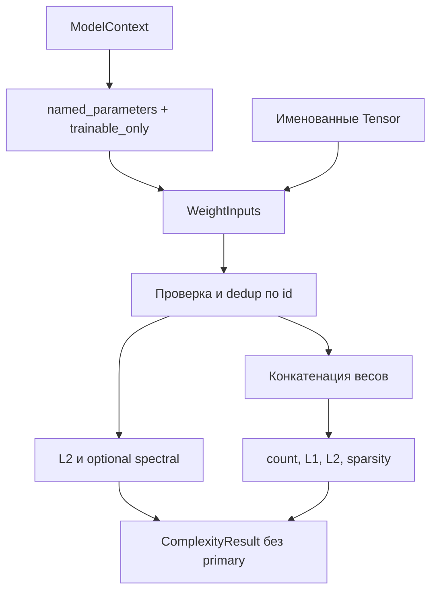

# Диагностики весов

_Карта `dl_complexity.diagnostics`: выбранные параметры, локальные нормы и агрегаты без forward по данным._

---

## 🧭 Объекты и ответственность

Модуль экспортирует `DiagnosticEstimator`, `WeightInputs`, `WeightStatistics` через [__init__.py](__init__.py). Он измеряет свойства конкретного представления весов. Нормы, число коэффициентов и доля нулей не получают автоматически интерпретацию MDL, информационного критерия или границы риска.

| Файл | Объект | Назначение |
| --- | --- | --- |
| [base.py](base.py) | `DiagnosticEstimator` | Семейная база, наследующая [ComplexityEstimator](../base.py) без новой логики |
| [inputs.py](inputs.py) | `WeightInputs(weights, provenance=None)` | Именованное отображение Tensor, которые требуется измерить |
| [weights.py](weights.py) | `WeightStatistics(trainable_only=False, spectral=False)` | Выбор параметров из контекста и расчёт статистик |

Публичные методы оценщика — унаследованные `check`, `estimate` и свойство `config`. `_check_context`, `_prepare_context`, `_estimate` — защищённые методы реализации. `WeightStatistics.uses_data=False` сообщает [ComplexitySuite](../evaluation.py), что этот метод не расходует общий источник данных.

`WeightInputs` — frozen dataclass с сохранением ссылок. Конструктор не копирует Tensor и не сканирует значения. Если тензоры изменились между вызовами, следующая оценка увидит новые значения.

## 🔄 От выбора параметров к результату



Путь `estimate(context)` выбирает `context.model.named_parameters()`. По умолчанию включены и замороженные параметры. `trainable_only=True` оставляет только `requires_grad=True`. Buffers не включаются.

Путь `estimate(inputs=WeightInputs(...))` использует переданное отображение непосредственно. Фильтр `trainable_only` к нему не применяется, поскольку выбор Tensor уже выполнен вызывающим кодом. В обоих случаях повторное появление того же объекта Tensor считается один раз. Разные объекты с общей памятью считаются раздельно.

`check(context)` подтверждает наличие контекста без чтения значений весов. Для готового `WeightInputs` действует базовая проверка типа записи и provenance. Пустое отображение, смешанный dtype/device и нечисловые значения обнаруживаются при `estimate`.

## 📏 Состав результата

| Ключ | Вычисление | Единица |
| --- | --- | --- |
| `<name>.l2` | Евклидова норма всех элементов одного Tensor | `weight_norm` |
| `<name>.spectral` | Наибольшее сингулярное число, только для Tensor с `ndim == 2` и `spectral=True` | `weight_norm` |
| `parameter_count` | Число элементов выбранных уникальных Tensor | `count` |
| `l1` | Сумма модулей элементов общего вектора | `weight_norm` |
| `l2` | Евклидова норма общего вектора | `weight_norm` |
| `sparsity` | Доля элементов, точно равных нулю | `dimensionless` |

`ComplexityResult.kind == "weight_diagnostics"`, `primary_name` отсутствует и `primary is None`. По одному объекту можно получить несколько независимых характеристик, без искусственного общего scalar score.

Имена локальных величин относятся к первому встреченному имени Tensor. У связанных параметров aliases не создают дополнительные нормы или копии коэффициентов. Поле provenance при пути через контекст содержит только объявленный `state_id`, поскольку данные и likelihood не использовались.

## ⚙️ Вычислительная работа и память

Пусть `J` — число переданных имён параметров, `P` — число элементов после исключения повторных объектов. Для матриц обозначены размеры `m × n`. Приведён анализ операций реализации, без измерения скорости.

| Функции и этапы | Стоимость |
| --- | --- |
| Конструктор `WeightInputs`, `WeightStatistics.__init__`, `_check_context` | `O(1)` по объёму весов. Создание записи не копирует вложенное отображение |
| `WeightStatistics._prepare_context` | `O(J)` по объектам параметров и отбору имён, без копирования значений Tensor |
| Finite scan, локальные L2, flatten, глобальные L1/L2 и сравнение с нулём в `_estimate` | `O(J + P)` времени. `torch.cat` выделяет вектор `O(P)`, промежуточные значения и autograd добавляют память того же порядка |
| Спектральные нормы в `_estimate` | Дополнительно плотная SVD-работа порядка `O(Σ mn min(m,n))`, плюс рабочая память линейной алгебры для выбранных матриц |
| Сборка результата | `O(J)` локальных записей и несколько глобальных `Quantity` |

Поддерживаются только floating Tensor с конечными значениями. Глобальная конкатенация требует общего dtype и device. Проверки `isfinite(...).all()` могут синхронизировать GPU. Norm-операции сохраняют доступный autograd, вычисление точной доли нулей не даёт полезного гладкого градиента.

`parameter_count` хранится в dtype весов через `vector.new_tensor(...)`. При большом `P` float16/bfloat16 и другие конечные форматы могут округлить целое число. Это ограничение представления результата, а не изменение числа выбранных коэффициентов.

Спектральная норма 2D weight-матрицы не равна автоматически норме convolution-оператора. Для многомерных фильтров spectral-результат не вычисляется. Нормы также зависят от параметризации: два набора весов могут задавать одну функцию и иметь разные нормы.

## 🧪 Пример с повторным именем Tensor

```python
import torch
from dl_complexity.diagnostics import WeightInputs, WeightStatistics

weight = torch.diag(torch.tensor([3.0, -2.0, 1.0], dtype=torch.float64))
inputs = WeightInputs({"weight": weight, "same_tensor": weight})
result = WeightStatistics(spectral=True).estimate(inputs=inputs)

assert result.primary is None
assert result.quantities["parameter_count"].value.item() == 9
assert result.quantities["l1"].value.item() == 6
assert result.quantities["weight.spectral"].value.item() == 3
assert "same_tensor.l2" not in result.quantities
```

Численные примеры с checkpoint, связанными параметрами и эквивалентными функциями находятся в [test_torch_integration.py](../../../tests/test_torch_integration.py) и [test_analytical_integration.py](../../../tests/test_analytical_integration.py). Общее владение моделью описано в [context.py](../context.py), формулы и операции — в [CODE_WALKTHROUGH](../../../docs/CODE_WALKTHROUGH.md#core-diagnostics), сигнатуры — в [API_REFERENCE](../../../docs/API_REFERENCE.md#reference-diagnostics).
