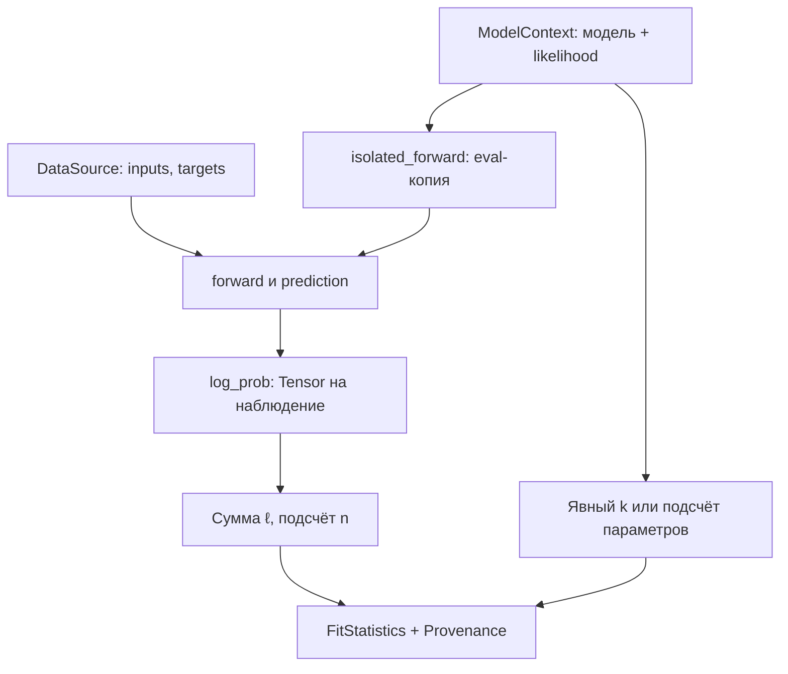
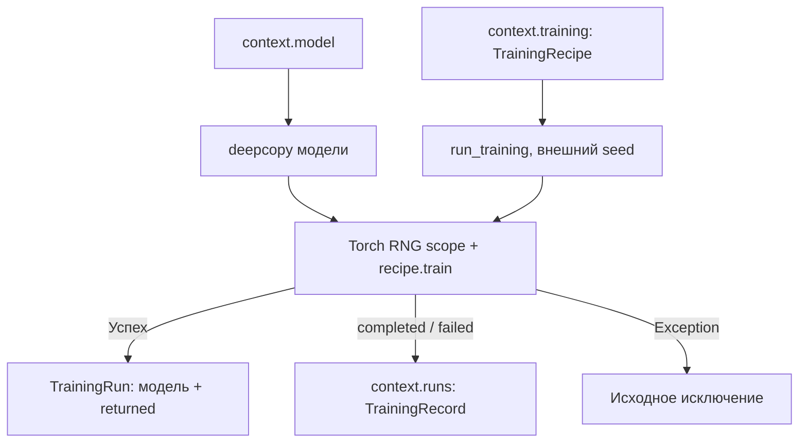

# PyTorch-интеграция

_Карта `dl_complexity.integrations.torch`: pointwise likelihood, изолированная оценка модели и явный запуск обучения._

---

## 🧭 Структура и публичные границы

Этот пакет связывает обычные `nn.Module` с численными входами оценщиков. Модели остаются PyTorch-объектами. Интеграция не вводит собственную базовую нейросеть и не требует телеметрического декоратора.

| Файл | Публичный API | Внутренняя реализация |
| --- | --- | --- |
| [likelihood.py](likelihood.py) | `CategoricalLikelihood`, `GaussianLikelihood`, `prepare_fit_statistics` | Валидация batch, observation axis и суммирование likelihood |
| [training.py](training.py) | `TrainingRun`, `run_training` | Вложенная функция `record(status)` сохраняет метаданные запуска |
| [model.py](model.py) | Не экспортируется через пакетный `__all__` | `model_rng_scope`, `isolated_forward` и вложенный `forward` |
| [__init__.py](__init__.py) | Пакетные импорты перечисленных публичных имён | Дополнительной логики нет |

`model_rng_scope` и `isolated_forward` имеют имена без начального подчёркивания, но используются как внутренние helpers интеграции. Они не являются дополнительными методами оценщиков.

Объекты [ModelContext и TrainingRecipe](../../context.py), [DataSource](../../data.py), [FitStatistics](../../criteria/inputs.py) определены за пределами пакета. `ModelContext` хранит раздельно `loss` и `likelihood`, рецепт обучения и объявленные ID. Произвольный loss не преобразуется в нормированную плотность автоматически. `context.structure` описывает модули и параметры, без forward-графа или архива активаций.

## 📐 Likelihood сохраняет ось наблюдений

Оба адаптера возвращают `Tensor[N]` с натуральными логарифмами. Они суммируют event-координаты, но не усредняют batch.

| Метод | Вход | Вычисление и выход |
| --- | --- | --- |
| `CategoricalLikelihood.log_prob` | Logits `[N,C]`, индексы классов `[N]` с dtype `torch.long` | `log_softmax(logits, -1)` и `gather` по истинному классу, результат `[N]` |
| `GaussianLikelihood.log_prob` | Prediction и target строго одинаковой формы `[N,...]`, фиксированный `sigma > 0` | Normal log density на каждой координате и сумма event axes, результат `[N]` |

Для Gaussian вычисляется

$$
\ln p(y_i\mid\mu_i)
=\sum_j\left[-\frac12\left(\frac{y_{ij}-\mu_{ij}}{\sigma}\right)^2
-\ln\sigma-\frac12\ln(2\pi)\right].
$$

Константы нормировки включены. МSE без значения `sigma` и этих констант не задаёт тот же likelihood. Непрерывная плотность может превышать единицу, а её NLL быть отрицательной. Для длины дискретного кода отдельно нужна точность квантования.

Categorical-адаптер не предполагает class weights, label smoothing и soft labels. Gaussian не выполняет broadcasting разных shapes. Часть ошибок, например выход индекса класса за границы, обнаруживает сам PyTorch.

## 🔄 Оценка текущих весов



`prepare_fit_statistics(context, data=..., parameter_count=...)` выполняет следующие операции:

1. Проверяет наличие явного likelihood и объекта `DataSource`.
2. Определяет `k`: число элементов уникальных `Parameter` в режиме `"trainable"`, `"all"` или заданное целое число. Подсчёт коэффициентов не устанавливает эффективную статистическую размерность.
3. Получает callable из `likelihood.log_prob` либо использует сам `likelihood`.
4. Для каждого `(inputs, targets)` вычисляет prediction и likelihood. Выход должен иметь форму `[N_batch]`, согласованную с осью 0 targets, и быть конечным.
5. Суммирует likelihood по всем наблюдениям. Проверяет, что фактическое `n` положительно и совпадает с `DataSource.n_observations`, если оно объявлено.
6. Возвращает `FitStatistics(ℓ, k, n)` и объявленные state/data/likelihood ID.

Один источник может быть исчерпан даже при ошибке, обнаруженной в конце прохода. Для повторных оценок подходят повторно итерируемые данные, фабрика batches либо сохранённые готовые статистики.

`isolated_forward` сначала делает `deepcopy(model)` и переводит копию в `eval()`. Отдельные клоны исходных параметров и buffers передаются в `torch.func.functional_call`. Параметрические клоны сохраняют autograd-связь с исходными leaves. Tuple inputs превращаются в позиционные аргументы модели. Режимы модулей, параметры и buffers исходной модели при обычном PyTorch-forward сохраняются.

`model_rng_scope` сохраняет и восстанавливает CPU Torch RNG, RNG CUDA-устройств, на которых лежат параметры/buffers, и MPS RNG при наличии MPS-тензоров. Восстановление выполняется и при исключении. Python/NumPy RNG, произвольные внешние устройства и глобальные побочные эффекты пользовательского forward не изолируются. Невозможность `deepcopy` требует готовых численных входов вместо этого пути.

## 🏋️ Явное обучение на копии



`run_training(context, seed=...)` требует `context.training`. Функция копирует модель и вызывает `recipe.train(copy, **dict(recipe.config))`. Выбор optimizer, данных, числа шагов и возврат callable принадлежат рецепту. Обычный `estimate` его не запускает.

`TrainingRun` содержит обученную копию, фактический `returned`, объявленную цель, конфигурацию и внешний Torch seed. `returned` не отсоединяется от autograd и может удерживать большие графы. В `context.runs` сохраняется `TrainingRecord` с метаданными: функция не добавляет туда обученную модель или `returned`. Конфигурация копируется неглубоко, поэтому её вложенные пользовательские объекты остаются общими.

Внешний `seed` управляет Torch RNG scope. Поле `recipe.config["seed"]`, если оно есть, остаётся отдельным аргументом callable. Цель `objective` хранится как декларация, без анализа кода обучения. При обычном `Exception` во время scoped-вызова добавляется запись `failed`, затем исключение пробрасывается. Ошибка раннего `deepcopy` и `BaseException`, например `KeyboardInterrupt`, этим обработчиком не записываются.

## ⚙️ Цена интеграции и владение памятью

Обозначения: `P` — элементы параметров, `V` — элементы buffers, `J` — число их объектов, `K` — число устройств, `H` — число полей конфигурации. `N` — наблюдения, `E` — event-координаты, `C` — классы. Это анализ операций, без benchmark.

| Функции | Работа и память |
| --- | --- |
| Конструкторы likelihood, `GaussianLikelihood.__post_init__`, конструктор `TrainingRun` | `O(1)` по размеру данных. Проверка `sigma` скалярная, Tensor-значения не копируются |
| `CategoricalLikelihood.log_prob` | `O(NC)` времени и log-softmax intermediates |
| `GaussianLikelihood.log_prob` | `O(NE)` времени и промежуточных значений |
| `model_rng_scope` | Обход `O(J + K)`, сохранение/восстановление состояний RNG. Значения всех весов не сканируются |
| `isolated_forward`: вход и выход из context manager | `O(P + V)` копирования значений плюс Python-объекты. Одновременно хранятся private model и дополнительные клоны |
| Вложенный `forward` | Обычная стоимость forward выбранной модели плюс функциональная подстановка параметров |
| `prepare_fit_statistics` | Копирование состояния, обход параметров и полный проход forward/likelihood по данным. Суммирование и finite scan требуют `O(N)` сверх вычисления модели и likelihood |
| `run_training` | Копия модели плюс стоимость пользовательского обучения. Несколько shallow-копий конфигурации требуют `O(H)` |
| Вложенный `record(status)` | `O(H)` на копию config и одну запись метаданных |

Адаптер не включает `torch.no_grad()` автоматически. При включённом autograd сумма по batches удерживает графы всех forward, поэтому память не ограничена размером одного batch. Если производные не нужны, вызывающий код может явно использовать `with torch.no_grad():`. Проверки конечности и извлечение scalar способны синхронизировать GPU. Наличие кода для CUDA/MPS не означает, что все device-пути проверены в данном окружении.

## 🧪 Минимальный путь к BIC

```python
import torch
from torch import nn
from dl_complexity import DataSource, ModelContext
from dl_complexity.criteria import BIC
from dl_complexity.integrations.torch import GaussianLikelihood, prepare_fit_statistics

model = nn.Linear(1, 1, bias=False, dtype=torch.float64)
with torch.no_grad():
    model.weight.fill_(2.0)
data = DataSource.from_tensors(
    torch.tensor([[1.0], [2.0]], dtype=torch.float64),
    torch.tensor([[2.0], [4.0]], dtype=torch.float64),
)
context = ModelContext(model, likelihood=GaussianLikelihood(sigma=1.0))
statistics = prepare_fit_statistics(context, data=data)
result = BIC().estimate(inputs=statistics)
assert statistics.k == 1 and statistics.n == 2
assert result.primary.unit == "native_ic"
```

Загрузка обычного `state_dict` выполняется через [ModelContext.from_checkpoint](../../context.py). Нужна factory с известными архитектурой и dtype. Интеграция не восстанавливает Python-архитектуру, likelihood или историю обучения из одного checkpoint.

Проверки сохранности состояния, autograd, RNG и запусков рецепта находятся в [test_torch_integration.py](../../../../tests/test_torch_integration.py) и [test_analytical_integration.py](../../../../tests/test_analytical_integration.py). Подробное вычислительное объяснение — в [CODE_WALKTHROUGH](../../../../docs/CODE_WALKTHROUGH.md#core-torch), сигнатуры — в [API_REFERENCE](../../../../docs/API_REFERENCE.md#reference-integrations).
